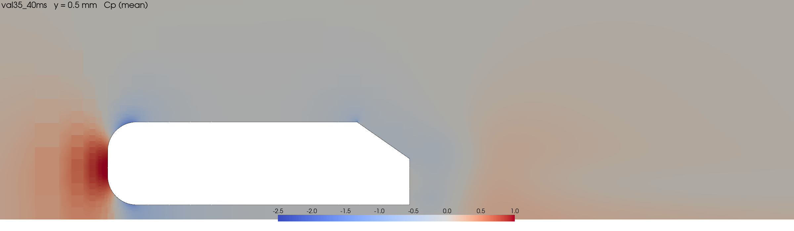
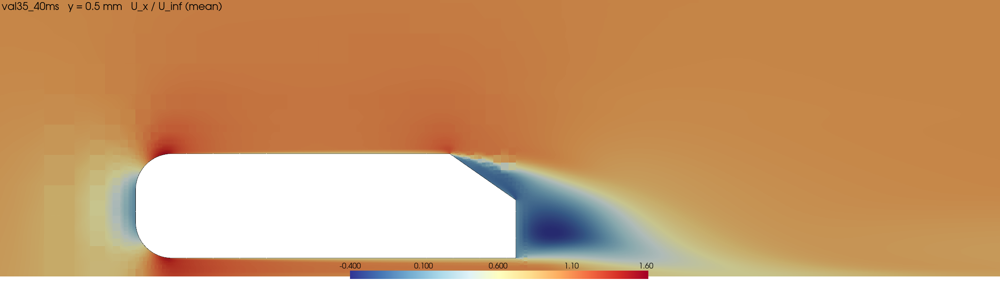
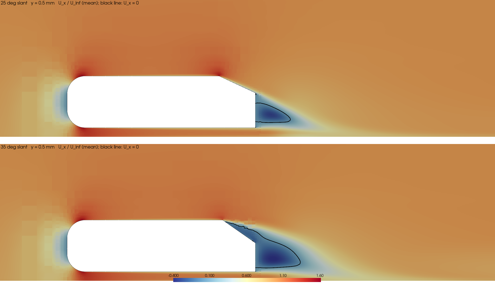
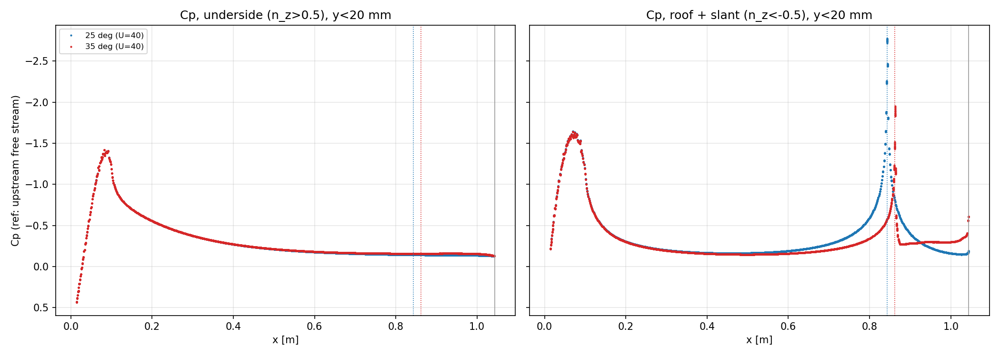

# Project 01: Ahmed body

Steady RANS simulation of the Ahmed body in OpenFOAM 11, checked against ERCOFTAC
wind-tunnel data at two rear-slant angles (25° and 35°).

**Status: in progress.** The validation cases are run and documented. Mesh independence
was not studied, drag could not be checked against measurement, and the parametric part
of the study consists of two angles. Section 2 says exactly what is and is not
established.

## 1. Overview

The Ahmed body is a simplified road-vehicle shape that produces a three-dimensional
separated wake. Its rear slant angle controls the wake: at 25° the flow stays attached
over the slant and the wake recirculation sits behind the base, and at 35° the flow
separates over the slant. It is a standard test case for turbulence models because the
drag depends on where and how the flow separates.

**Question.** Can steady RANS with k–ω SST and wall functions reproduce the measured
wake of the Ahmed body, and what does a comparison with experiment show about where the
model succeeds and fails?

**Approach.**

1. Build a mesh with checked quality and a documented wall treatment.
2. Run the case until the force coefficients are stationary, judged by a criterion fixed
   beforehand.
3. Compare the symmetry-plane velocity field with the ERCOFTAC laser-Doppler data against
   criteria fixed before the runs.
4. Repeat at a second slant angle.
5. Report disagreements and investigate their causes, without tuning to match.

The project also contains an earlier exploratory sweep (0°–35°, 60 m/s) that was later
found to carry several errors. It is kept for the record and kept apart from the
validation work (section 7).

## 2. Where the project stands

| Area | Status |
|---|---|
| Geometry, mesh, solver set-up | done for 25° and 35° |
| Stationarity of forces | passed at 25° and, after restarting the averaging window, at 35° |
| Comparison with ERCOFTAC Experiment 2 (40 m/s) | done at 25° and 35°; results below |
| Drag against measurement | **no verdict**: the reference paper prints no 25° drag value, and there is no measured 35° drag in this project |
| Mesh-independence study | **not done**, by an early decision. Numerical error is unknown |
| Parametric study | two angles only; a two-point comparison, not a trend |
| Reproducibility | the 40 m/s, 25° case was re-run from the tracked files and reproduced the window statistics; the other cases were not re-run |
| Exploratory sweep (0°–35°) | **not validated**; see [errata](docs/errata.md) |

By the portfolio's own completion criteria, which ask for verification, validation and a
parametric study, the project is not yet complete. The missing piece with the largest
effect is the mesh-independence study, because without it a disagreement with experiment
cannot be assigned to the model rather than to the mesh.

## 3. Set-up

| Item | Value |
|---|---|
| Body | standard Ahmed body (1.044 × 0.389 × 0.288 m), 100 mm nose fillet, sharp rear edges |
| Slant angles | 25° and 35° |
| Ground clearance | 50 mm, stationary floor (matching the wind-tunnel set-up) |
| Domain | half-domain with a symmetry plane at y = 0; 2 L upstream, 6 L downstream, 1 L half-width, 2 L high (x from −2.088 to 6.264 m, y from 0 to 1.044 m, z from 0 to 2.088 m) |
| Flow | 40 m/s (Re_L ≈ 2.8 × 10⁶), the speed of the ERCOFTAC Experiment 2 data; one additional 60 m/s run at 25° |
| Model | k–ω SST with wall functions; incompressible, steady SIMPLEC (`foamRun`, `incompressibleFluid`) |
| Inlet turbulence | intensity 0.25 % and νt/ν = 10 at the nose, chosen from the experiment and reached with the inlet values k₀ = 0.027751 m²/s², ω₀ = 176.1 s⁻¹ (checked at the nose: 0.253 %, 10.09) |
| Reference area | 0.056016 m² (half of the full frontal area, because the domain is a half model) |
| Averaging | `fieldAverage1` over a window that passes the stationarity criterion |

**Mesh.** `snappyHexMesh` with surface refinement level (6 7), uniform wake box at level 3,
and no boundary-layer prisms. The 25° mesh has 2,725,204 cells and the 35° mesh 2,706,513.
`checkMesh` reports OK on both: maximum non-orthogonality 32.9°, maximum skewness 0.953,
maximum aspect ratio 3.42. The skewness maximum is the highest in the project and its
location was never found. Wall-function use was checked on the slant: y⁺ ranges from
17.9 to 116.5 with a median of 43.8, 73 % of cells inside 30–300 and 27 % below 30.
A wall-resolved mesh was tried first and abandoned (see
[development-log.md](docs/development-log.md)).

**Stationarity.** Steady RANS here does not settle to a point; forces oscillate about a
mean. The criterion fixed beforehand is that the drift of Cd over the averaging window,
divided by its standard deviation, is below 0.5 in magnitude **and** four sub-window means
differ by less than 2 %.

## 4. Results at 25° slant

Full detail: [docs/validation-25deg.md](docs/validation-25deg.md).

The reference data are ERCOFTAC AC1-05, Experiment 2 (laser-Doppler anemometry on the
symmetry plane). They are © ERCOFTAC 2004 and are not redistributed here, so **no figure
in this repository shows measured points**. The outcomes below are pass/fail results and
pooled error metrics.

| ID | Criterion (fixed before the run) | Result |
|---|---|---|
| C1 | Drag against Ahmed et al. (1984) | **no verdict** (no 25° value is printed in the paper) |
| C2 | No reversed flow above the slant at the measured points | pass |
| C3a | Reversed flow at the wake stations 38, 88, 138 mm | pass (10, 8, 6 reversed points against 8, 7, 6 measured) |
| C3b | Recirculation ends within 138–288 mm | pass (CFD end in (188, 238] mm, the measured interval) |
| C4 | Pooled normalised RMS error of U and W: ≤ 0.05 good, 0.05–0.10 fair, > 0.10 poor | 0.1020, **poor** (slant points 0.185, wake points 0.067) |
| C5 | Free-stream and floor turbulence | report only: the measured free-stream k is 5.6–7.8 times the CFD value |

**What agrees.** The size and position of the wake recirculation match the measurements
closely: the number of reversed points at the three near-wake stations and the end of
the recirculation are right.

**What does not.** Over the slant the CFD velocity 15 mm above the surface is 1.5–2.6 times the
measured value (31–42 m/s against 13–28 m/s), and the two diverge between the slant
stations at −163 and −143 mm. The CFD boundary layer on the slant is thinner and fuller
than the measured one.

**A turbulence sensitivity test.** The measured free stream is noisier than the CFD
one, so a second run raised the nose turbulence to 0.5 % and νt/ν = 20 (two quantities
changed together). The pooled error fell from 0.1020 to 0.0960, which moves it from
poor to fair. This is a sensitivity test, not a replacement for the 0.25 % baseline,
and the improvement is small.

**Decision.** The remaining slant-layer discrepancy is documented and not pursued further:
no other wall treatment or turbulence model was tried.

**Forces.** At 40 m/s, Cd = 0.28672 and Cl = 0.32051 (reference area 0.056016 m²,
stationary window 1000–2000 iterations). At 60 m/s the Cd is 0.28864, 0.67 % higher.
The slant carries 50.8 % of the total Cd and the base 37.2 %, together about 88 %;
friction accounts for 16.4 %. There is no measured value to compare these with.

## 5. Results at 35° slant

Full detail: [docs/validation-35deg.md](docs/validation-35deg.md).

The first 1000 averaged iterations (1000–2000) failed the stationarity criterion because
the solution was still relaxing early in the window. The averaging was restarted at
iteration 2000 and the window 2000–3000 passes (Cd mean 0.29687, drift/std −0.006,
sub-window spread 0.05–0.16 %). The comparison criteria were stated before this run.

| ID | Criterion | Result |
|---|---|---|
| C2′a | Reversed flow at every measured slant station, −123 to −3 mm | pass |
| C2′b | First reversed station in {−163, −143, −123} mm (measured −143) | pass (−123) |
| C3′a | Reversed flow at all wake stations | **fail**: none at 287 mm, where 11 points are reversed in the measurement |
| C3′b | Recirculation end within 50 mm of the measured end | pass (CFD end in (237, 287] mm; measured end in (287, 337]) |
| C4′ | Pooled normalised RMS error of U and W | 0.1529, **poor** (slant points 0.146, wake points 0.155) |
| C1′ | Drag | no verdict (no measured 35° drag) |

The model reproduces the appearance of reversed flow over the slant, starting one
station later than measured. It places too much reversal near the base and too little
farther downstream, so the recirculation is shorter than measured. The wake error is more
than twice that at 25° (0.155 against 0.067).

**25° compared with 35° in the CFD.** Between the two runs the wake recirculation grows
from 188 mm to 240 mm in extent and from 0.0147 to 0.0320 m² in area, a slant-attached
recirculation appears (0.0055 m²), and Cd rises from 0.28672 to 0.29687 (3.5 %). This
comparison is between two CFD runs on the same mesh settings. It is not a measured
drag trend: the classical Ahmed result is a drag maximum near 30° and a fall at larger
angles, and the CFD does not obviously show that fall. With two angles and no measured 35°
drag, that difference is an open point.

## 6. Limitations

What the project does **not** establish:

- **Numerical error.** There is no mesh-independence study at either angle, so a
  disagreement with experiment cannot be attributed to the model alone.
- **Drag accuracy.** No pass/fail comparison with measured drag exists. At 25° the source
  paper prints no value; at 35° the project has no measured drag.
- **The slant boundary layer.** It is not reproduced at 25° (section 4).
- **A trend with slant angle.** Two angles are a comparison, not a trend.
- **The effect of inlet turbulence at 35°.** It was tested only at 25°.
- **Unsteady behaviour.** The model is steady RANS. Stationary mean forces do not mean
  the real flow is steady.
- **Run-to-run identity.** The 40 m/s, 25° run was reproduced in window statistics only,
  not bit for bit. The 35° stage 3 was run by hand.

Wall functions place the first cell at y⁺ between 18 and 117, with 27 % of slant cells
below 30. A wall-resolved alternative failed to mesh on this geometry.

## 7. Corrections to earlier work

The first version of this project (a 0°–35° sweep at 60 m/s) contained errors that were
found later. They are listed here briefly and explained in
[docs/errata.md](docs/errata.md).

| ID | What was wrong |
|---|---|
| E1 | The force coefficients in the sweep are half-body values (multiply by 2) |
| E2 | The body sits on the floor at 0°, 10°, 20°, 30° and 35°; only 25° has the 50 mm clearance |
| E4 | Inlet turbulence of the sweep is about 5 % (assumed), far above the experiments |
| E5 | The Strouhal-number literature check is unsupported |
| E6 | `resolveFeatureAngle` and `includedAngle` were treated as one setting |
| E7 | "No steady solution exists" and "the oscillation is physically real" overstated the evidence |

The sweep results are in [docs/transient-sweep.md](docs/transient-sweep.md). They
are exploratory and not validated, and they are not used in sections 4 and 5. Where older
material calls a mesh "validated" or a frequency "cross-validated", that means internal
consistency only.

## 8. Repository layout

~~~text
01-ahmed-body/
├── README.md                this file
├── requirements.txt         Python package versions
├── docs/                    detailed documents (index below)
├── geometry/                CAD generation and STL checks
├── mesh/                    original meshing notes
├── cases/                   OpenFOAM cases (val25_*, val35_*, and the sweep slant*)
├── scripts/                 analysis scripts
│   ├── validation/          validation driver and comparison scripts
│   └── visualization/       flow-visualisation scripts
├── validation/reference_data/   notes on obtaining the ERCOFTAC data (no data stored)
└── results/                 figures for the validation cases and the sweep
~~~

Raw solver output and meshes are not stored; they are rebuilt from the tracked
dictionaries.

## 9. Reproducing

OpenFOAM 11 and the packages in `requirements.txt` are needed. A validation case is
rebuilt and run with one command (about 5 hours at 8 ranks), and the comparison scripts
run on the result.

~~~bash
scripts/validation/run_validation_case.sh cases/val25_clr50_40ms ~/runs/val25_40ms --np 8
~~~

Details, the 35° three-stage procedure, tool versions, what was and was not verified and
how to obtain the ERCOFTAC data are in [docs/reproducibility.md](docs/reproducibility.md).

## 10. Documentation index

| Document | Contents |
|---|---|
| [docs/validation-25deg.md](docs/validation-25deg.md) | 25° validation: criteria, results, slant-layer diagnostic, drag decomposition |
| [docs/validation-35deg.md](docs/validation-35deg.md) | 35° validation, stationarity restart, 25° against 35° |
| [docs/transient-sweep.md](docs/transient-sweep.md) | exploratory 0°–35° sweep and its caveats |
| [docs/development-log.md](docs/development-log.md) | meshing and first-transient development, with dead ends |
| [docs/reproducibility.md](docs/reproducibility.md) | how to rebuild and re-run |
| [docs/errata.md](docs/errata.md) | corrections E1–E7 |

## 11. References

- Ahmed, S.R., Ramm, G., Faltin, G. (1984). *Some Salient Features of the Time-Averaged
  Ground Vehicle Wake.* SAE Technical Paper 840300. <https://doi.org/10.4271/840300>
- Lienhart, H., Becker, S. (2003). *Flow and Turbulence Structure in the Wake of a
  Simplified Car Model.* SAE Technical Paper 2003-01-0656.
  <https://doi.org/10.4271/2003-01-0656>
- Lienhart, H., Stoots, C., Becker, S. (2000). *Flow and Turbulence Structures in the Wake
  of a Simplified Car Model (Ahmed Model).* DGLR Fach-Symposium, Stuttgart. (Source of the
  ERCOFTAC Experiment 2 data; title as printed on the ERCOFTAC page, not independently
  checked.)
- ERCOFTAC Classic Collection, Application Challenge AC1-05 "Ahmed body", © ERCOFTAC 2004.
  <https://kbwiki.ercoftac.org/w/index.php/Test_Data_AC1-05> (accessed 2026-10-11). The
  measured data are not redistributed in this repository.
- Thacker, A., Aubrun, S., Leroy, A., Devinant, P. (2013). *Experimental characterization
  of flow unsteadiness in the centerline plane of an Ahmed body rear slant.* Experiments
  in Fluids 54, 1479. <https://doi.org/10.1007/s00348-013-1479-5> (cited in the errata
  entry E5).
