# Project 01 — Ahmed Body: 25° Slant, External Aerodynamics

## Status
**ERRATA (2026-10-02): the force coefficients reported in this README are half-body values (multiply by 2) and the 50 mm ground clearance is not modelled in the 0°, 10°, 20°, 30° and 35° cases (the 25° case has it), and the inlet turbulence of the sweep (5%, assumed) is far higher than in the reference experiments. See the Errata section immediately below this block.**

**Update (2026-10-10):** the corrected 25° validation case (50 mm clearance, half-body reference area, inlet turbulence matched to the experiment) has been run at 40 and 60 m/s and compared with ERCOFTAC AC1-05 Experiment 2: the wake recirculation is reproduced, the slant boundary layer is not, and the drag comparison with Experiment 1 (criterion C1) was given **no pass/fail verdict** because the source paper prints no 25° drag value and its two drag curves disagree there (corrected 2026-10-10). See Section 10.10. This supersedes the statement further down that the validation case is still planned.

**Update (2026-10-11):** Section 8.0 now states in one place what the project does
and does not establish. In short: the wake recirculation of the validation case is
reproduced, the slant boundary layer is not, and drag accuracy at 25° is not
established. The 0°-35° sweep is not validated and its angles are not comparable
(E1, E2, E4). Where the text below calls the 25° case's mesh "validated" or its wake
dynamics "cross-validated", that means internal consistency only, not agreement with
experiment (E2, E5). The 40 m/s validation case was rebuilt from the tracked files
with the driver script and reproduced the window statistics; the 60 m/s and Tu 0.5 %
cases were not re-run with it.

**Case frozen at commit `72af160`.** The 25° slant / 60 m/s condition is
complete: mesh validated, steady and transient CFD results obtained,
wake dynamics cross-validated against an independent probe measurement.
No further changes will be made to this case. Work is proceeding to
additional slant angles in the case matrix.

**Update:** the 0° slant angle case has completed mesh generation,
steady-baseline analysis, and a transient PIMPLE investigation with an
honest, inconclusive frequency result — see Section 10.5. The 10°
case has completed the same full pipeline, including flow
visualization; its transient frequency result is also inconclusive,
but for a different and better-characterized reason (visible
amplitude modulation, not simple noise) — see Section 10.6. The 20°
case has also completed the same full pipeline (steady baseline
skipped entirely by decision, not just shortened); its transient
frequency result is likewise inconclusive, this time due to too few
measured cycles (CoV 43% on only 3 intervals) rather than amplitude
modulation or drift — see Section 10.7, which also documents a newly
found peak-detection prominence-sensitivity issue. The 30° case —
the angle closest to Ahmed's documented drag-crisis transition —
skipped the steady solver run entirely (not just the full baseline)
and kept its transient mesh at level (5,6) rather than stepping down
to (4,5); its frequency result is a fourth distinct kind of
inconclusive outcome (continuous multi-scale fluctuation with no
stable amplitude threshold), and its flow visualization shows a
wake field that is nearly frame-invariant despite the irregular
force signal — see Section 10.8. The 35° case — the last angle
in the sweep — followed 30°'s approach (steady solver run
skipped) but kept the (4,5) transient mesh, and its run was
extended from 0.2 s to 0.3 s after the 0.2 s analysis showed the
near-stationary window was too short. It is the first angle whose
force record reaches a window with drift smaller than its
fluctuation (Cd 0.1589 over t = 0.14-0.30 s), and its frequency
analysis narrowly fails a pre-stated corroboration criterion, so no
Strouhal number is reported — see Section 10.9. Remaining planned
work for this project: the 25°/40 m/s validation case and a final
limitations pass. [Updated 2026-10-11: both are done; see Section 10.10, Section 8.0 and the
2026-10-11 update above.]

## Errata (added 2026-10-02; supersedes earlier statements where they conflict)

*Added after the 35° case was published (commit `97a9ffb`), following an
audit of the case setups. Earlier sections are left as written, in line
with this repository's rule of correcting forward rather than rewriting
history. Where an earlier section conflicts with this one, this one
takes precedence.*

### E1. All reported Cd, Cl and Cm are half-body values

The domain is a half-domain (symmetry plane at y = 0), so the
`ahmedBody` patch is the half body. The `forceCoeffs` definition in
every case integrates the force over that patch but normalizes it with
Aref = 0.112032 m^2, the **full** frontal area (0.389 x 0.288), and has
no symmetry factor. Measured on the 35° steady mesh: the patch spans
y = 0 to 0.1945 m and its projected frontal area is 0.056018 m^2, i.e.
0.5000 x 0.112032 (faces looking upstream and downstream give the same
area, so the patch is a closed surface). All twelve case directories that
define one (steady and transient, 0° to 35°) use the same `forceCoeffs`
definition, and they share the same half-domain setup, so the
same factor is expected everywhere, **but the area was measured on the
35° mesh only**. Assuming a symmetric mean flow, every reported Cd, Cl
and Cm is half the full-body value; the correction is a factor of 2.

| Case / window (as reported in this README) | Reported | Multiplied by 2 |
|---|---|---|
| 0° steady, Cd, iterations 1200-2000 | 0.151413 | 0.302826 |
| 25° steady, Cd, iterations 1000-2000 | 0.152808 (std 0.001670) | 0.305616 (std 0.003340) |
| 10° transient, Cd | 0.1433 (std 0.0044) | 0.2866 (std 0.0088) |
| 10° transient, Cl | 0.5986 (std 0.0032) | 1.1972 (std 0.0064) |
| 20° | no mean Cd or Cl value reported | - |
| 30° transient (0.06-0.2 s), Cd | 0.1629 (std 0.0057) | 0.3258 (std 0.0114) |
| 30° transient (0.06-0.2 s), Cl | 0.7615 (std 0.0067) | 1.5230 (std 0.0134) |
| 35° (0.14-0.30 s), Cd | 0.15890 (std 0.00300) | 0.31780 (std 0.00600) |
| 35° (0.14-0.30 s), Cl | 0.71462 (std 0.00255) | 1.42924 (std 0.00510) |

Other Cd, Cl and Cm values quoted elsewhere in this README (window
sensitivity values, sub-window means, per-frame figures) scale by the
same factor. **Not affected**: flow fields, pressure and velocity
statistics, frequencies and Strouhal-number analyses, mesh quality,
percentage-type statistics (sub-window spreads, drift/std ratios) and
the qualitative conclusions about wake behaviour.

### E2. The body sits on the ground plane in the 0°, 10°, 20°, 30° and 35° cases; the 25° case has the 50 mm ground clearance

*Corrected 2026-10-04. The first version of this item (commit `612e1dd`)
said that the clearance was missing in every case, including 25°. That
was wrong: it was inferred from the generator's STL files and from a
measurement on the 35° mesh, before the 25° case's own STL had been
opened.*

Section 1 lists a 50 mm ground clearance as part of the reference
configuration. The geometry generator builds the body with its
underside at z = 0 and states that the clearance is handled in the CFD
case setup. Measured by reading the STL used inside every case
directory: the three 25° case directories use an STL raised by 50 mm
(z from 0.050 to 0.338 m), while the STLs in all other case directories
(0°, 10°, 20°, 30°, 35°) span z = 0 to 0.288 m, i.e. the body rests on
the floor (domain floor at z = 0, identical `blockMeshDict` in these
cases; the early `slant25_re4.29M` directory has a different
`blockMeshDict` and was examined only through its STL).

Checked on the meshes themselves:
- 25° (frozen mesh): `ground` patch at z = 0; body patch z = 0.050 to
  0.338 m; projected area in z of 0.20091 m^2 facing up and 0.20091 m^2
  facing down, i.e. the underside face is present and there is an
  underbody gap.
- 35°: `ground` patch at z = 0; body patch z = 0 to 0.288 m;
  downward-facing projected area 0.0152 m^2 against 0.2009 m^2 facing
  upward, i.e. no underside face and no underbody gap.
- 0°, 10°, 20°, 30°: the conclusion rests on the STL files and the
  common domain definition; their meshes were not measured.

Consequences:
- The sweep is internally inconsistent: the 25° case includes an
  underbody gap and its flow, the other angles do not. Cd and Cl trends
  across slant angle (even after the factor-2 correction of E1) mix two
  geometries and should not be read as a slant-angle effect.
- For the five angles without clearance, the simulated geometry is a
  body resting on the ground plane, with no underbody flow. Their
  absolute coefficients, and lift in particular (the doubled 35° Cl of
  about 1.4 should not be taken as a result), are not comparable with
  published Ahmed-body data.
- The 25° case is closest to the reference configuration, but nothing
  in this repository has yet been validated against experiment. Wording
  such as "mesh validated" and "wake dynamics cross-validated against an
  independent probe measurement" in the Status block refers to internal
  consistency checks (mesh quality; agreement between a force-signal
  frequency and a wake-probe frequency), not to comparison with
  experimental data.
- Trends across slant angle and the observations about wake dynamics
  describe the geometry that was actually simulated at each angle.

### E3. Status of the 25° case and next steps

The 25° case frozen at commit `72af160` has the half-body
coefficient issue (E1) and the inlet-turbulence difference (E4) but, unlike
the other angles, it does have the 50 mm ground clearance (see E2); it
remains unmodified, as the freeze instruction requires, and its
corrections are recorded here. A corrected validation case (25° slant, 50 mm clearance,
half-body reference area 0.056016 m^2, steady RANS, compared with the
ERCOFTAC AC1-05 data) is planned but **not started**. Its scope is not
final, and no result of it is claimed here.

**Update 2026-10-10:** the corrected validation case was built and run after this section was written, so it is no longer "not started" and its scope is now fixed; the results, including criterion C1 (drag against Experiment 1), which received no pass/fail verdict (corrected 2026-10-10: the source paper prints no 25° drag value), are reported in Section 10.10. The frozen 25° case itself remains unmodified.

### E4. Inlet turbulence differs strongly from the reference experiments

All twelve sweep case directories (steady and transient, 0° to 35°) use
one identical `0/include/initialConditions` file (verified by checksum):
U = 60 m/s, k = 13.5 m^2/s^2, omega = 91.79 1/s. The file records the
turbulence intensity as **assumed** to be 5% (k = 1.5 (U I)^2, omega
from a length scale of 0.07 L). With nu = 1.5e-5 m^2/s this corresponds
to a free-stream eddy-viscosity ratio nut/nu = k/(omega nu) of about
9.8e3.

According to the ERCOFTAC AC1-05 test-data documentation, the reference
experiments report a turbulence intensity below 0.5% (Ahmed et al.
1984, 60 m/s) and below 0.25% with a viscosity ratio of about 10
(Lienhart et al., 40 m/s). At the inlet, the sweep's intensity is
therefore 10 to 20 times higher and its eddy-viscosity ratio about 980
times higher than in the experiments. (Turbulence decays along the
2.088 m inlet length, so the values at the body are lower than at the
inlet; that decay was not measured in these cases.)

This was an assumption recorded in the case files; the README did not
state it. Its effect on the results has **not been tested**. A high
free-stream eddy viscosity could damp unsteadiness and smear shear
layers, which would bear on the wake-dynamics and frequency
observations, but that is a hypothesis and not a finding. The unsteady
results of the sweep should be read as results for this inlet
condition. The planned validation case is intended to use inlet
turbulence matched to the experiments.

### E5. The Strouhal-number literature check in Sections 6.3, 7 and 9.4 is not supported (added 2026-10-11)

Section 6.3 states that the characteristic length of the Strouhal number
(body height H) was "verified against literature, not assumed", cites
"Thacker et al. 2010, on this same 25 deg geometry", and compares the
result with a published range of 0.18-0.21 and with "0.24 (aspect-ratio
studies)". On 2026-10-11 these statements were checked and are **not
supported**:

- The 25 deg rear-slant study by Thacker, Aubrun, Leroy and Devinant
  (Experiments in Fluids 54, 1479, 2013; DOI 10.1007/s00348-013-1479-5)
  defines its Strouhal numbers on the mean reattachment length (about 0.11
  for the 20 Hz bubble and shear-layer motion, 0.6-0.7 for high-frequency
  shear-layer activity) and, for Kelvin-Helmholtz vortices, on the
  shear-layer vorticity thickness (about 0.2). It reports no 0.18-0.21
  slant-surface shedding Strouhal number defined on body height, and its
  reference list contains no Thacker 2010 paper (its only Thacker reference
  is J. Wind Eng. Ind. Aerodyn. 107-108, 237-243, 2012). No source was found
  for the "2010" citation, for 0.18-0.21 as defined here, or for 0.24. They
  are unverified and are withdrawn as comparison values.
- St = f H / U_inf with H = 0.288 m is therefore a **choice of definition**,
  not a literature-verified convention. The frequency (about 65.4 Hz) is
  unchanged. The arithmetic of Section 9.4 is consistent (the body-length
  value 1.14 and the height-based value 0.31 differ by L/H = 3.625), but the
  statement that literature verification supports the height-based convention
  is unsupported. The statement that St 0.31-0.34 is "on the higher end of
  published values" is withdrawn: no valid published comparison value is
  given anywhere in this README.
- "Cross-validated" in Sections 6.3, 7 and 8 refers to the 0.33% agreement
  between the force frequency and a wake-probe frequency, both taken from
  the same transient run. That shows the oscillation is a consistent feature
  of this simulation. It is **not** validation against experiment and does not
  show that the oscillation is physical; the inlet turbulence of E4 and the
  coarsened transient mesh remain untested influences. Read it as internal
  consistency only.

---

## 1. Engineering Objective

Investigate the aerodynamic behavior of the Ahmed body at a 25° rear
slant angle — the angle most studied in the literature and the one
with the most reliable published reference data (Ahmed et al. 1984;
Lienhart & Becker 2003) — using RANS CFD, with explicit verification
and validation at every stage.

**Reference configuration**
- Geometry: standard Ahmed body, length L = 1.044 m, width W = 0.389 m,
  height H = 0.288 m, 25° rear slant, 50 mm ground clearance, 100 mm
  front-nose fillet radius (approximation of the real, digitized nose
  profile — see Section 8)
- Freestream velocity: U∞ = 60 m/s (Ahmed 1984 convention)
- Reynolds number: Re_L = U∞L/ν = 4.18×10⁶ (ν = 1.5×10⁻⁵ m²/s)
- Turbulence model: k-ω SST (RAS)

**Research question**: can steady and transient RANS reproduce the
known separation and wake-unsteadiness behavior of the Ahmed body at
this slant angle, and what does the resulting drag/wake signal show
about the applicability of a steady-state assumption to this flow?

---

## 2. Geometry and Domain

- Parametric geometry generated in CadQuery (`geometry/generate_ahmed_body.py`),
  matching Ahmed (1984) dimensions exactly, with the front nose modeled
  as a tangent-fillet approximation (R = 100 mm, corroborated by two
  independent literature sources) rather than the raw digitized scan
  data (see Section 8, Limitations).
- Computational domain: half-domain with a symmetry plane at the
  vehicle centerline (y = 0), exploiting the zero-yaw symmetry of the
  mean flow. Domain extent: 2L upstream, 6L downstream, 1L half-width,
  2L height (x ∈ [−2.088, 6.264] m, y ∈ [0, 1.044] m, z ∈ [0, 2.088] m).
- Ground: stationary no-slip wall (matching the actual Ahmed 1984 and
  Lienhart & Becker 2003 wind-tunnel setups — neither used a moving
  belt).
- Top and outer (far-field) boundaries: slip walls.

---

## 3. Mesh Strategy and Validation

### 3.1 Wall treatment decision
The project initially targeted a **wall-resolved** (y+ ≈ 1) near-wall
strategy with an 18-layer boundary-layer stack, the standard choice
for maximizing separation-prediction accuracy in RANS. This was
**abandoned** after extensive investigation (see Section 9) found a
geometric incompatibility between automated boundary-layer extrusion
and the Ahmed body's rear trihedral corners (where the slant edge,
side edge, and rear vertical face converge), independent of layer
count, domain size, or available hardware.

The project pivoted to a **high-Re wall-function** strategy:
`nutkWallFunction` / `kqRWallFunction` / `omegaWallFunction`, targeting
y+ = 30–300 (the documented valid range for these OpenFOAM 11 boundary
condition implementations, verified against the source code and a
matching external-vehicle-aerodynamics tutorial, not assumed). No
boundary-layer/prism cells are used; near-wall resolution is provided
entirely by isotropic surface refinement.

### 3.2 Mesh generation and verification
- Generated with `snappyHexMesh`, surface refinement level (6,7) on
  the body (steady case): **2,725,204 cells**.
- `checkMesh`: **Mesh OK** — max non-orthogonality 32.9°, max skewness
  0.95, max aspect ratio 3.42, zero illegal faces in every category.
- Independent y+ verification (`scripts/compute_yplus_layer.py --wallfunction`):
  the chosen refinement level places wall-adjacent cells at y+ ≈ 97–194
  for this Re/velocity, within the intended 30–300 wall-function range
  — confirmed analytically before the mesh was trusted, not assumed
  from the refinement level alone.

---

## 4. Steady RANS Baseline (SIMPLEC)

Solved with `foamRun -solver incompressibleFluid`, k-ω SST, SIMPLEC
(`consistent yes`), `residualControl` at 1×10⁻⁴ for p, U, k, ω.

**Result**: residuals decreased substantially over the first 1000
iterations, then **plateaued** between iterations 1000–2000 (only ω
ever converged below the 1×10⁻⁴ threshold). Drag coefficient did not
converge to a fixed point — instead:

| Quantity | Value |
|---|---|
| Cd mean (iterations 1000–2000) | 0.152808 |
| Cd standard deviation | 0.001670 |
| Dominant oscillation period (FFT) | 17.26 iterations |
| Peak/background spectral power ratio | 167,354× |

This is an extremely clean, unambiguous **limit cycle** in the
solver's iteration history — residuals and Cd oscillate around a
stable mean rather than converging to a point. Because iteration count
in a steady SIMPLEC solve is a pseudo-time relaxation parameter, not a
physical timestep, this period has **no direct physical-time or
frequency interpretation** on its own — but its existence motivated
the transient investigation below.

---

## 5. Transition to Transient (PIMPLE)

Converted the case to transient PIMPLE to determine whether the
observed limit cycle reflects genuine flow unsteadiness. Turbulence
model, wall treatment, and boundary conditions were kept unchanged;
only the time-integration approach changed (see Section 9 for the two
non-trivial bugs found and fixed during this conversion).

**Mesh resolution trade-off**: the full 2.7M-cell mesh, even
parallelized across 8 MPI ranks, required an impractical wall-clock
time to reach a statistically useful physical duration given
hardware/thermal constraints on the development machine. The mesh was
coarsened in two documented steps for the transient run only (the
steady-case mesh above is unaffected):

| Stage | Refinement level | Cells | Notes |
|---|---|---|---|
| Steady baseline | (6,7) | 2,725,204 | Fully validated, used for Section 4 |
| Transient, step 1 | (5,6) | 1,264,455 | `Mesh OK`, verified stable |
| **Transient, final** | **(4,5)** | **872,391** | `Mesh OK`, used for all transient results below |

**Final transient configuration**: 872,391 cells, 8 MPI ranks
(hierarchical decomposition, balanced to <0.1% cell-count deviation),
`maxCo = 0.5` (`adjustTimeStep` active), initial `deltaT` computed
from actual mesh/velocity data (not guessed).

Measured performance: **~2.4 s/timestep** (mean), pressure (GAMG) the
dominant per-timestep cost (mean 6.4 iterations, up to 22), consistent
with standard incompressible-PIMPLE cost distribution.

---

## 6. Transient Results

### 6.1 Stationarity
Starting from uniform initial conditions (not the steady-state result
— see Section 9.2), the flow was run to t = 0.20 s. Windowed-mean
analysis (0.02 s windows) showed the initial startup transient
resolving by t ≈ 0.045–0.06 s, after which windowed Cd means agreed
within ~1–2% of each other with no systematic drift. **The flow reaches
statistical stationarity by t ≈ 0.06 s** (≈3.4 body-length
flow-through times).

Selected stationary analysis window: **t = 0.06–0.20 s**.

### 6.2 Statistics (stationary window, t = 0.06–0.20 s)

Computed directly from the concatenated `forceCoeffs.dat` output
(`scripts/compute_stationary_stats.py`), n = 7281 samples, restricted
to t = 0.06–0.20 s, with leftover steady-case pseudo-time directories
excluded (see script header for details).

| Quantity | Cd | Cl |
|---|---|---|
| Mean | 0.1619 | 0.1204 |
| Std. dev. (raw, stationary window) | 0.0039 | 0.0500 |
| Min / max | 0.1563 / 0.1698 | 0.0492 / 0.1936 |
| Sub-window mean range (4 equal sub-windows) | 0.1606–0.1628 | — |

**Caveat, stated explicitly**: Cl showed measurably more residual
linear drift within the stationary window (~9.7% over the full
window) than Cd (~0.9%) — Cd statistics are more trustworthy than Cl
statistics from this run. The raw Cl std dev above (0.0500) is ~41%
of the Cl mean, a large relative spread that is consistent with —
not a resolution of — this drift concern: it should be read as
further evidence that Cl has not reached a stationary state in this
window, not as a validated fluctuation amplitude. Cd's std dev
(0.0039, ~2.4% of its mean) does not show this problem.

### 6.3 Frequency and Strouhal number

Both Cd and Cl gave **identical** dominant frequency in every window
tested. Time-domain peak-to-peak measurement (more reliable than the
FFT bin estimate, given the limited number of cycles available) across
two independent 0.07 s sub-windows agreed to within ~1%:

| Metric | Value |
|---|---|
| Time-domain period (sub-window 1) | 0.01523 s (CoV 0.81%) |
| Time-domain period (sub-window 2) | 0.01538 s (CoV 0.06%) |
| Corresponding frequency | ≈ 65.4 Hz |

**Independent wake-probe cross-check**: sampled velocity at a fixed
near-wake point (x = 1.15, y = 0.10, z = 0.15 m) using the already-saved
transient field data (no re-solving). All three velocity components
independently gave the same dominant frequency, in close agreement
with the force signal:

| Signal | Frequency |
|---|---|
| Integrated force (Cd/Cl) | 65.36 Hz |
| Near-wake velocity probe | 65.57 Hz |
| **Agreement** | **0.33%** |

**[Corrected 2026-10-11, see E5: the literature claims in this subsection are
unsupported; the height-based St is a choice, and the comparison values below
are unverified.]**

**Strouhal number — characteristic length verified against
literature, not assumed**: Ahmed-body wake-shedding studies
(Thacker et al. 2010, on this same 25° geometry; aspect-ratio wake
studies) define St using body **height H**, not length L (L is the
correct convention for Re in this project, but a different quantity):

St = f·H/U∞, H = 0.288 m → **St ≈ 0.31–0.34**

Published values for comparable Ahmed-body slant/wake shedding modes:
Thacker et al. (2010), 0.18–0.21 (slant-surface shedding); aspect-ratio
studies, 0.24 (C-pillar contraction/expansion mode). Our result is the
same order of magnitude but on the higher end of published values —
most plausibly attributable to the coarsened transient mesh (Section 6
mesh table), not re-verified via a transient mesh-independence study.

### 6.4 Wake visualization

Velocity contours on a longitudinal slice through the near wake,
across 7 timesteps spanning ~2 shedding cycles, show a reverse-flow
recirculation bubble immediately behind the slant surface with
**visibly changing size and shape** cycle-to-cycle — elongating and
contracting rather than static. This is consistent with the
**"bubble pumping"** mechanism specifically documented in the
literature for this geometry (cyclic contraction/expansion of the
near-wake recirculation bubble), rather than confirmed classical
alternating vortex shedding, which was not distinguished with
certainty from this evidence alone.

---

## 7. Engineering Conclusions

1. **A genuinely steady RANS solution does not exist for this flow at
   this slant angle** — the persistent, high-quality limit cycle in
   the steady solve, combined with the transient run's sustained
   periodic wake oscillation, is strong, convergent evidence of real
   flow unsteadiness that a steady formulation cannot resolve to a
   fixed point.
2. **The observed ~65 Hz oscillation is a physically real wake
   phenomenon**, not a numerical artifact — supported by three
   independent lines of evidence: (a) internal consistency between Cd
   and Cl (identical frequency, 0% difference), (b) cross-validation
   against an independent wake-velocity probe (0.33% agreement), and
   (c) visual confirmation of an evolving recirculation structure
   consistent with a literature-documented mechanism.
3. [Corrected 2026-10-11, see E5: the literature comparison is unsupported.]
   The corrected Strouhal number (St ≈ 0.31–0.34, using the
   literature-verified height-based convention) is in the right order
   of magnitude relative to published values, though higher than the
   most directly comparable literature figures — a limitation
   attributed to mesh coarsening, not treated as a validated match.

---

## 8. Limitations — What Should Not Be Concluded

### 8.0 Consolidated statement of scope (added 2026-10-11; supersedes the bullets below wherever they conflict)

This block ties together errata E1-E5 and Section 10.10. The bullets that follow
are the original Section 8 text, left visible. Read them with this scoping: they
describe the **0°-35° sweep**, not the validation case. The second bullet ("no
value compared with experiment; the 40 m/s Lienhart & Becker case remains
unexecuted") was true for the sweep and is superseded by Section 10.10 for the
validation case.

**What the project establishes**

- On the validation case (25° slant, 50 mm ground clearance, half-body Aref
  0.056016 m², inlet turbulence matched to the experiment, steady SIMPLEC,
  k-omega SST with wall functions) the CFD reproduces the measured wake
  recirculation: reversed-flow point counts at x = 38/88/138 mm are 10/8/6
  against 8/7/6 measured, and the end of the recirculation lies in the same
  interval as the measurement, (188, 238] mm (C3, pass). No reversed flow is
  found over the slant at the measured points (C2, pass; the lowest measured
  point is about 14-15 mm from the surface, so this check cannot see a thin
  bubble). The wake-only normalised RMS error of U and W is 0.067 ("fair").
- The baseline run is statistically stationary over iterations 1000-2000
  (drift/std -0.12, four-window spread 0.09 %), and the 40 m/s case was
  rebuilt and re-run from the tracked files with the driver script, reproducing
  the window statistics (histories are not bit-identical; Section 10.10).

**What the project does not establish**

- **The slant boundary layer is not reproduced.** About 15 mm above the slant
  the computed speed is 1.5-2.6 times the measured one, and the pooled C4 error
  is 0.1020 ("poor", just above the 0.10 threshold; slant-only 0.185). The cause
  (wall resolution, the RANS/SST model, free-stream turbulence, or a mix) is
  untested. The Tu 0.5 % run is a sensitivity test, not a resolution of this.
- **Drag accuracy at 25° is not established.** No usable measured 25° drag value
  exists in the sources available: SAE 840300 prints no 25° value, and two of its
  figures disagree with each other when read at 25° (Section 10.10, C1). C1 is
  reported as informational, with no pass/fail verdict. The CFD has no stilts,
  no tare correction and no open test section, and the reference area of the
  experiment is not stated.
- **No mesh-independence or wall-treatment study** was done (project decision),
  so model error cannot be separated from numerical error and no comparison
  carries an uncertainty estimate.
- **The 0°-35° sweep is not validated and not comparable across angles.**
  Its force coefficients are half-body values (multiply by 2; E1). The body sits
  on the floor in the 0°, 10°, 20°, 30° and 35° cases and has the 50 mm clearance
  only at 25° (E2). All sweep cases used an inlet turbulence of about 5 %
  intensity with a viscosity ratio near 9,800, far above the experiments (E4).
  The effect of that setting on the sweep results was never tested.
- **Strouhal numbers and frequencies in the sweep are internal results.** They
  were compared with themselves, not with experiment, and the literature support
  once cited for them is withdrawn (E5). The height-based Strouhal number is a
  choice of definition.
- **Scope of the validation:** one geometry, one slant angle, one turbulence
  model, steady RANS, symmetry-plane (y = 0) data only; the 60 m/s and Tu 0.5 %
  cases were not re-run with the driver.

- **The transient mesh (872,391 cells, level 4,5) is coarsened ~3.1×**
  from the mesh validated for the steady case. No mesh-independence
  study was performed at this transient resolution. The frequency and
  Strouhal number above should be read as a genuine, cross-validated
  [corrected 2026-10-11, see E5: internal consistency within one run, not
  validation against experiment] qualitative finding, not a quantitatively converged result.
- **No mean/RMS Cd or Cl value from this project has been compared to
  Ahmed (1984) or Lienhart & Becker (2003) experimental data.** Doing
  so would require, at minimum, matching the exact experimental
  Reynolds number condition (this project's 40 m/s / Re 2.78×10⁶
  Lienhart & Becker case remains unexecuted) and a mesh-independence
  study — neither of which has been done.
- **The front nose is a tangent-fillet approximation** of the real,
  digitized nose profile (documented and justified in
  `validation/reference_data/README.md`), not the exact experimental
  geometry.
- **Cl statistics carry more uncertainty than Cd** due to observed
  residual drift within the nominally stationary window (Section 6.2).
- **The wake mechanism is identified as consistent with "bubble
  pumping,"** based on visual inspection of 7 timesteps — this is not
  a rigorous mode-decomposition (e.g. POD/DMD) analysis, and classical
  alternating vortex shedding has not been definitively ruled out as a
  contributing or alternative mechanism.
- **All decisions on mesh resolution, run duration, and rank count in
  the transient study were driven partly by hardware/thermal
  constraints** on the development machine, not purely by numerical
  or physical criteria — stated explicitly rather than presented as
  independent scientific choices.

---

## 9. Development & Troubleshooting (summary)

The full, unabridged investigation — every dead end, failed
configuration, and correction — is preserved in
`mesh/mesh_development_log.md`. Summary of the load-bearing findings:

**9.1 — Wall-resolved meshing failure.** Six-plus mesh iterations at
increasing refinement, multiple `resolveFeatureAngle` values, and
layer counts from 18 down to 5 all failed during boundary-layer
extrusion, either crashing the machine or producing zero retained
layers. Root cause, isolated via direct spatial analysis of
`cellLevel` data: severe cell inversion concentrated at the two rear
trihedral corners, independent of mesh size (reproduced on a mesh
6,300× smaller than the full-resolution attempt). A rear-corner fillet
was investigated and rejected on literature grounds (real Ahmed-body
corners are sharp; rounding them measurably changes drag). This
motivated the wall-function pivot (Section 3.1).

**9.2 — Transient conversion bugs.** (a) `ddtSchemes` in `fvSchemes` —
not `controlDict` or `fvSolution` — controls steady vs. transient
solver mode in OpenFOAM 11 (verified directly from source code); a
correctly-configured PIMPLE/timestep setup silently ran in steady mode
until this was found. (b) The steady SIMPLEC solution's `phi` (flux)
field is inconsistent with a PIMPLE/PISO transient restart, producing
Courant numbers wrong by 5 orders of magnitude; resolved by starting
the transient run from uniform initial conditions instead of
attempting flux reconstruction.

**9.3 — Frequency-analysis correction.** An initial FFT on the raw,
non-uniformly-sampled transient Cd(t) signal produced a spurious
"dominant period" equal to the analysis window length — an artifact of
analyzing a still-decaying envelope. Caught by comparing the FFT
result against a direct visual inspection of the signal and a
time-domain peak count, then corrected by resampling to a uniform grid
and restricting to the verified-stationary window (Section 6.1) before
recomputing.

**9.4 — Strouhal characteristic-length error.** An initial calculation
using body length L gave St ≈ 1.14 — implausible for bluff-body wake
shedding. [Corrected 2026-10-11, see E5: no supporting source was found.]
Literature verification found the wake-shedding convention
uses body height H, not L (L remains correct for this project's
Reynolds number definition, a different, unrelated quantity). This is
documented as a genuine error, caught before being reported as final.

---

## 10. Reproducibility

All geometry generation, meshing, case setup, and post-processing
scripts are under `geometry/`, `mesh/`, and `scripts/`. Case
dictionaries for all three case variants (steady wall-resolved
attempts, steady wall-function baseline, transient) are under
`cases/`. Raw solver field/mesh data is excluded from version control
(regenerable from scripts and dictionaries); quantitative results are
preserved as `.npz` arrays and the figures in `results/`.

---

## 10.5. Case Matrix Progress — 0° Slant Angle (60 m/s)

*Note: this section is a running log entry for the slant-angle sweep,
added in the case's own working style rather than fully integrated
into the numbered structure above. Will be consolidated when the
README is rewritten after the full sweep completes.*

**Case**: `slant00_re4.18M_symtest`. Same domain, BCs, turbulence
model, and wall-function strategy as the 25° case (Sections 2-3),
carried over as starting hypotheses and independently re-verified for
this geometry rather than assumed.

### Geometry
STL verified: 332 triangles, watertight, meter-scale (L=1.044,
W=0.389, H=0.288 m), volume 114.44 L — the largest in the sweep, as
expected (least material removed at 0° slant; monotonic with the 25°
body's 110.77 L).

### Feature-angle investigation (new finding, not present in the 25°
### workflow in this form)
An independent PyVista-based feature-edge sweep and OpenFOAM's own
`surfaceFeatures` utility were both used to determine
`includedAngle`/`resolveFeatureAngle` for this geometry. This
surfaced an important correction: **OpenFOAM's `includedAngle`
convention is the opposite of what a naive reading of PyVista's
`feature_angle` parameter suggests** — in OpenFOAM, higher values
select MORE edges (180°=all edges, 0°=none), confirmed against source
documentation, not assumed.

A systematic angle sweep of OpenFOAM's actual `surfaceFeatures` output
(`scripts/sweep_included_angle.py`) found a clean, unique answer:
**`includedAngle 90` / `resolveFeatureAngle 90`** — exactly 8 genuine
edges (4 rear box corners + 4 fillet-to-flat tangent-line corners),
zero tessellation noise. At 89°: 0 edges detected at all. At 91° and
above: edge count climbs continuously with no plateau, picking up
fillet tessellation noise. This is a materially different value from
the 25° case's 120°, because 0° geometry has plain right-angle box
corners (no slant face), structurally different from 25°'s oblique
slant/roof edges. **Confirms feature-angle settings do not transfer
between slant angles and must be independently re-derived per case**
— consistent with the project's standing "no assumed methodology
transfer" principle (see Section 8/9 of the original workflow).

### Mesh
- `blockMesh`: 32,500 background cells — identical to the 25° case,
  as expected (domain sizing is angle-independent, Section 2).
- `snappyHexMesh`: the wall-function strategy (`addLayers false`,
  surface refinement level (6,7)) was carried over from the validated
  25° mesh as a starting hypothesis, **not assumed valid** — it
  generalized successfully to this geometry. Result: 2,316,063 cells
  (vs. 2,725,204 at 25°).
- `checkMesh`: **Mesh OK.** Max non-orthogonality 44.9° (vs. 32.9° at
  25°), max skewness 0.90 (vs. 0.95), max aspect ratio 4.26 (vs.
  3.42). All comfortably within quality thresholds; the differences
  are plausibly attributable to the sharp 90° corner geometry vs.
  25°'s beveled slant, though this has not been independently
  verified by inspecting where in the mesh these maxima occur.

### Steady RANS baseline (SIMPLEC)
Ran to 2000 iterations. A mid-run issue was found and corrected: the
case's `controlDict` was discovered with `endTime 1000` instead of the
intended `2000` (root cause not conclusively identified — most likely
a copy/edit inconsistency, not a deeper problem); the run was resumed
via `startFrom latestTime` after fixing the value, with no other
changes.

Residuals plateaued in the same qualitative pattern as the 25° case:
Ux/Uy/Uz/p remained elevated (~1e-3 to 1e-2), only k/omega converged
below the 1e-4 threshold.

**Cd/FFT analysis required correcting two methodological errors before
reaching a reliable conclusion — documented here because catching
these errors is as important as the final result, per the project's
standing integrity principle:**

1. An initial full-window (iterations 1000-2000) FFT reported a
   "dominant period" of 200.20 iterations; a half-window (1000-1500)
   FFT reported 250.50 iterations. Both values are simple fractions of
   their respective window lengths (1000/5 and 500/2) — the same
   window-length-tracking artifact previously identified and corrected
   in the 25° transient-case frequency analysis (Section 6.3 /
   Section 9.3 above). Neither was a real signal.
2. A sliding-window sweep (`scripts/sweep_steady_windows.py`, using
   proper linear detrending rather than mean-subtraction) found a
   period that stays consistent across multiple window lengths (200,
   300, 500 iterations) and multiple start points, whenever the
   window's internal linear trend was small: **~22.2-22.7 iterations**.
   A subsequent single-window [1200,2000] FFT, even after correcting
   the analysis script to use full linear detrending, still returned a
   window-length-fraction artifact (200.25 ≈ 800/4) as its single
   strongest peak. Reporting the top 5 spectral peaks (rather than
   only the strongest) resolved this: the genuine ~22.5-iteration
   signal was present and reasonably strong (ranks 3-4, power ratio
   ~20,000x), while three window-length-fraction artifacts (800/2,
   800/4, 800/5) dominated the top of the ranking — a clear
   spectral-leakage signature (multiple peaks aligning with simple
   fractions of one window length) rather than independent physical
   modes.

**Final result**: Cd mean (iterations 1200-2000) = 0.151413,
std = 0.001857. Genuine limit-cycle period ≈ 22.5 iterations —
distinct from the 25° case's 17.26-iteration steady-solve period.

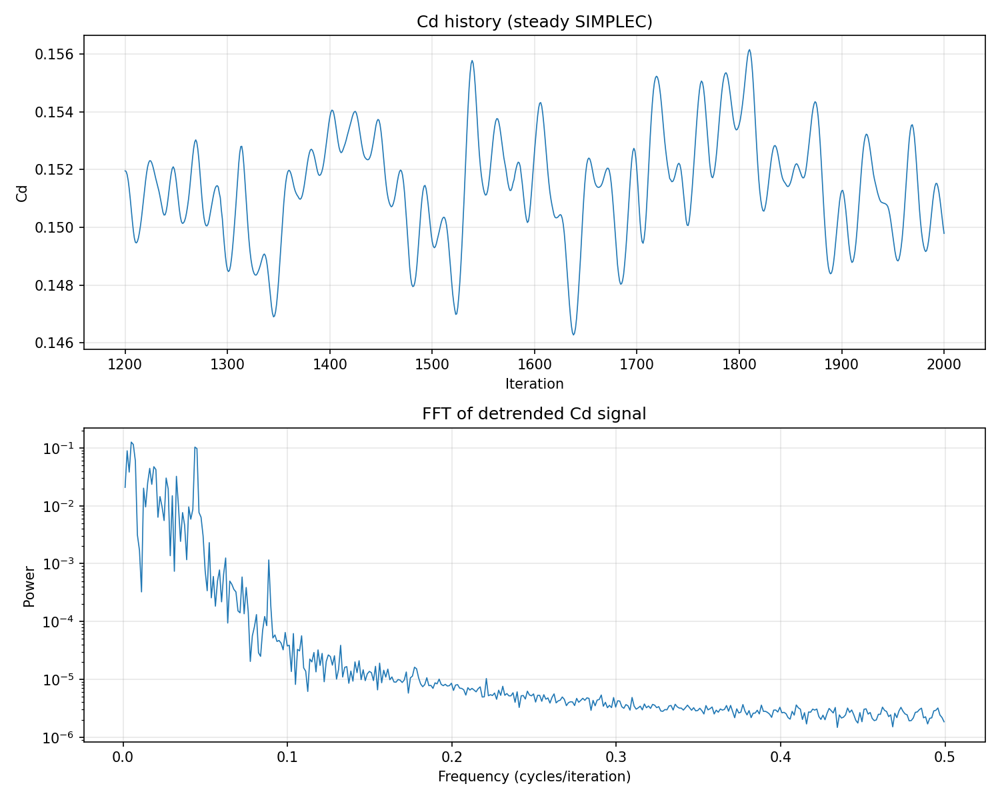

**Conclusion**: steady RANS does not converge to a fixed point at 0°
either, consistent with the 25° finding. The underlying physical
mechanism has not been independently confirmed to be the same kind of
unsteadiness (no wake visualization has been done for 0° yet, unlike
25°'s visually-confirmed "bubble pumping" mechanism) — this parallel
is currently based on the Cd/residual signature alone, not
cross-validated the same way 25° was.

### Transient PIMPLE investigation

Following the same decision as the 25deg case (steady RANS shows a
genuine limit cycle, not a fixed point), the case was converted to
transient PIMPLE. Mesh coarsened using the same strategy validated at
25deg (level (6,7)->(4,5)), but required an independent fix: the
default `nCellsBetweenLevels 3` caused persistent, non-convergent
castellation oscillation (22-49 cells/iteration, 45+ iterations, never
reaching `minRefinementCells`) with both explicit-feature and
refinement-shell selection criteria reporting 0 -- confirming the
oscillation was buffer/transition-layer driven, not caused by the
wake-refinement-box level or position (both tested and ruled out).
Reducing `nCellsBetweenLevels` to 2 resolved it cleanly (851,401 cells,
`checkMesh` OK, though max aspect ratio 6.20 is the highest seen in
this project to date -- a real, accepted trade-off of this fix, not
verified against solver stability beyond the runs performed).

**Numerical tolerance trade-off, explicitly accepted**: to reduce
wall-clock time given repeated hardware/scheduling constraints, the
PIMPLE pressure-solver tolerances were loosened from the 25deg case's
values (`pFinal` absolute tolerance 1e-7 -> 1e-4; non-final `p`
`relTol` 0.01 -> 0.05), giving roughly 19% faster wall-clock time per
unit of physical time. This measurably increased the reported "global"
time step continuity error (from consistently near-zero/scattered at
~1e-14 to a value that showed a monotonic within-stage drift up to
~1e-13), though the absolute magnitude remains small relative to the
flow. This is a genuine, documented deviation from the 25deg case's
numerical settings, not a like-for-like comparison at the solver
level.

**Data-integrity incident**: the run was interrupted by power outages
on two separate occasions, each truncating the actively-written
`forceCoeffs.dat` file mid-record and producing a single NaN row per
incident. These were identified and are now automatically dropped by
all analysis scripts (`load_forcecoeffs` in
`scripts/{analyze_steady_cd,inspect_early_transient,estimate_period_peaks}.py`)
before deduplication -- confirmed the solver's own field data was
unaffected (`startFrom latestTime` correctly resumed from the last
valid write in each case), only the diagnostic force-coefficient log
had truncated trailing rows.

**Frequency/period result: inconclusive, documented honestly rather
than forced to a number.** Peak-to-peak period measurements across
progressively larger windows ([0.2,0.3], [0.3,0.45]) consistently
showed high variability (CoV 46-48%) that did NOT improve with more
data, unlike the clean convergence seen in the 25deg case's frequency
analysis (CoV <1%). Measured inter-peak periods in the [0.3,0.45]s
window were 0.0201, 0.0186, 0.0221, 0.0495, 0.0163 s -- three
similar short periods, one notably longer gap, one short -- confirmed
via re-detection at a lower prominence threshold to be a genuine
feature of the signal (not a missed-peak artifact: no hidden cycle
exists in the long gap). **This is read as tentative evidence that
the 0deg wake oscillation may be irregular or amplitude-modulated
rather than single-frequency, unlike 25deg's clean ~65 Hz signal** --
but this is not confirmed with confidence, given the limited total
runtime (0.45s) relative to what would be needed to establish this
rigorously (e.g. via proper spectral analysis with many more cycles,
or POD/DMD mode decomposition, neither of which was performed).

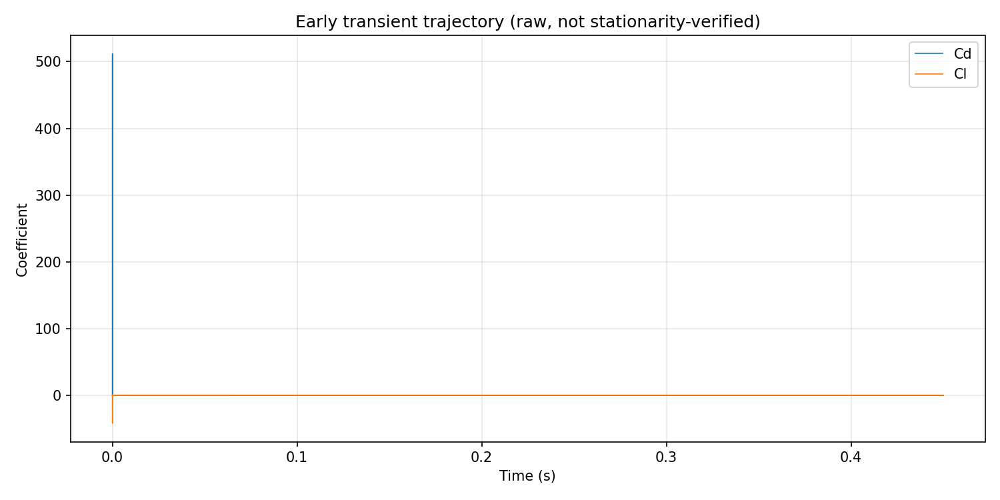
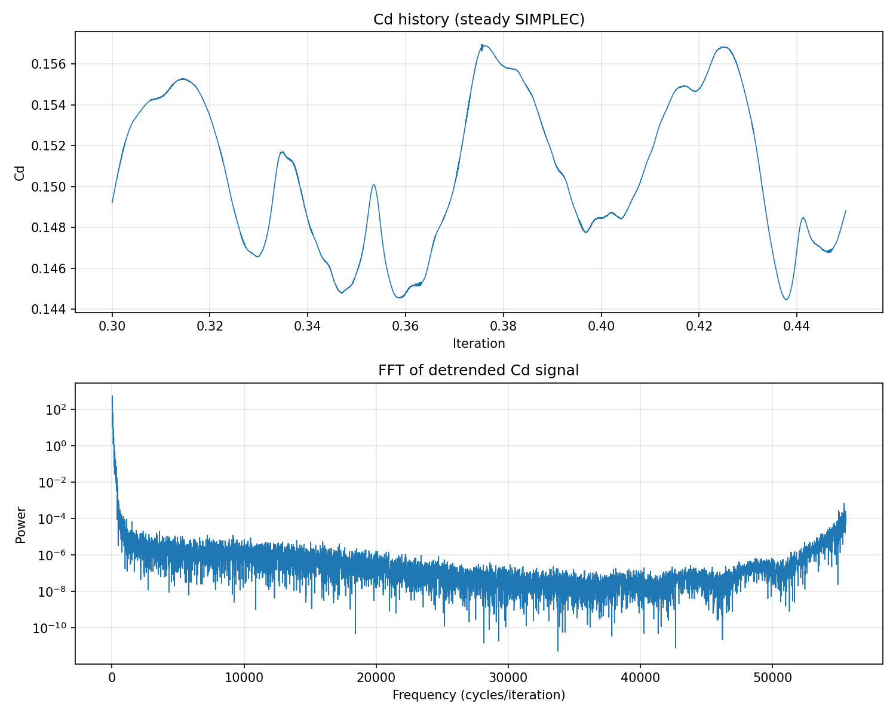
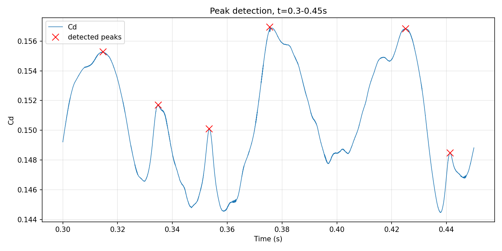

**Flow-field visualization**: a single-instant snapshot at t=0.45s
(streamwise velocity and pressure contours, y=0.10m longitudinal
slice, same slice convention as the 25deg case). This is explicitly
NOT a wake-evolution sequence like 25deg's 7-frame recirculation-
bubble visualization -- only two near-identical timesteps (t=0.449,
t=0.45, 0.001s apart) survived in the actual oscillation region of
this run, insufficient to show temporal evolution. The snapshot shows
a reverse-flow recirculation region (Ux down to -30 m/s against a
freestream that locally accelerates to ~85 m/s) coincident with a
clear low-pressure core (down to ~-492 m^2/s^2, recovering toward
freestream pressure downstream) -- consistent with the base-pressure
signature of a near-wake recirculation bubble, structurally similar in
character to 25deg's wake, though not confirmed as the same specific
mechanism ("bubble pumping" vs. other unsteadiness) given the single-
instant limitation. This provides a physical, visual cross-check that
the flow structure is sensible and consistent with the Cd/Cl
oscillation already documented, but does NOT independently confirm
the frequency/period finding above, which remains inconclusive.

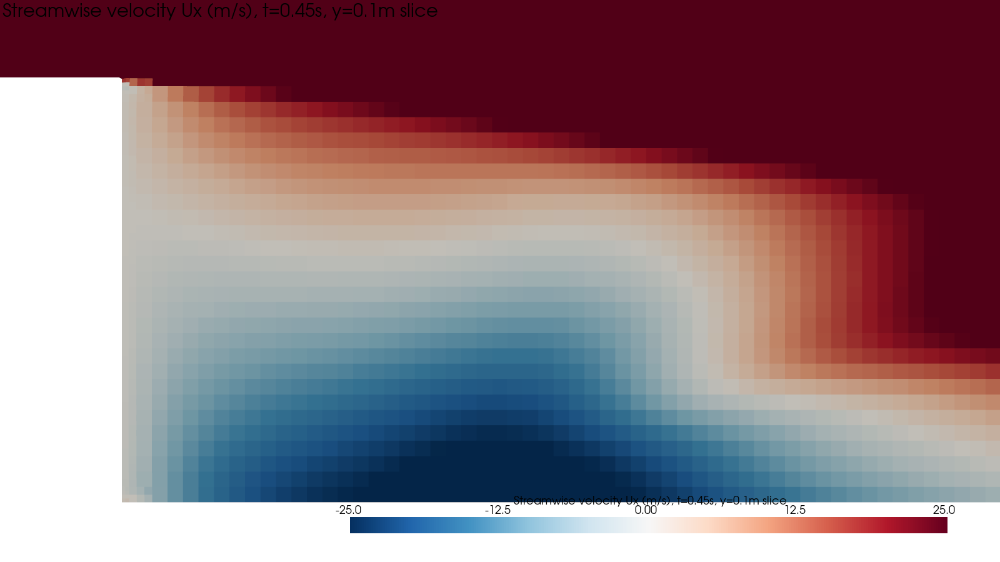
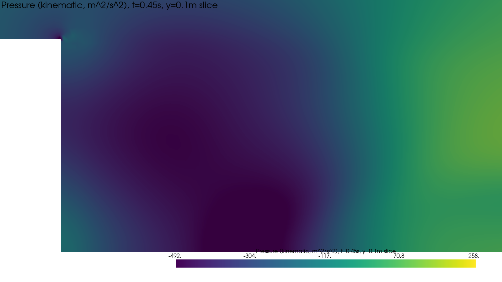

### Decision: transient-by-default for remaining angles
Given two consecutive, independently-analyzed angles (0°, 25°) both
show genuine steady-RANS non-convergence via a real limit cycle (not a
numerical bug in either case), the remaining sweep angles (10°, 20°,
30°, 35°) will proceed directly to transient PIMPLE, preceded by only
a short (~200-300 iteration) steady sanity check per angle — not a
full 2000-iteration run — to cheaply catch gross setup errors (bad
BCs, mesh/field mismatches) before committing to transient compute
time.

This is treated as a **working assumption for this sweep, not a
proven universal result**. In particular, 10°/20°/30° sit at or near
Ahmed's documented drag-crisis transition, where the wake flow
topology changes qualitatively (from more 3D, fully-separated flow to
more 2D/attached-like behavior on the slant, or vice versa depending
on direction of comparison) — it is not guaranteed that whatever
produces non-convergence at 0° and 25° generalizes to that regime, and
the short steady sanity-check is retained specifically to catch a
surprise convergence result if one occurs, rather than assuming all
five angles will behave identically.

### New scripts developed for this case (reusable for future angles)
- `scripts/sweep_included_angle.py` — runs OpenFOAM's actual
  `surfaceFeatures` utility across a range of `includedAngle` values
  and classifies extracted feature points by spatial region, to find
  a clean feature-angle threshold without guessing.
- `scripts/analyze_steady_cd.py` — Cd/Cl windowed-mean and FFT
  stationarity analysis for a steady-state case, updated during this
  investigation to use full linear detrending (not mean-only) and to
  report the top 5 spectral peaks rather than only the strongest, both
  changes made specifically because the mean-only/top-1 approach
  produced misleading results on this case's data.
- `scripts/sweep_steady_windows.py` — sliding-window sweep across
  multiple window lengths and start points, used to distinguish a
  genuine oscillation period (stable across window choices) from a
  window-length FFT artifact (period tracks window size).
- `scripts/inspect_early_transient.py` — quick raw Cd/Cl trend
  inspection for early-transient data, before a stationarity window is
  expected to exist yet.
- `scripts/compute_transient_deltat.py` — computes initial transient
  deltaT from the actual generated mesh's finest cell size (direct
  cell-extent measurement, cross-checked against a volume-based cube-
  root proxy), rather than assuming a value from a different case's
  mesh.
- `scripts/estimate_period_peaks.py` — time-domain peak-to-peak period
  estimation for transient Cd(t) signals, for cases with too few
  cycles for a reliable FFT; reports CoV across measured periods
  explicitly, with a caution flag when fewer than 3 periods are
  available.
- `scripts/visualize_snapshot.py` — single-instant velocity/pressure
  contour visualization on a longitudinal slice; prints actual field
  data statistics before rendering and auto-detects outlier-dominated
  color scales (switching to percentile clipping), after an initial
  render produced a misleadingly flat pressure plot traced to a few
  extreme outlier cells dominating a naive min/max color range.

All three shared-loading scripts (`analyze_steady_cd.py`,
`inspect_early_transient.py`, `estimate_period_peaks.py`) now also
drop NaN rows before deduplication, to handle truncated writes from
power interruptions (see Data-integrity incident above).

## 10.6. Case Matrix Progress — 10° Slant Angle (60 m/s)

*Same running-log style as Section 10.5, not yet integrated into the
numbered structure above.*

**Case**: `slant10_re4.18M_symtest` (steady sanity check) and
`slant10_re4.18M_symtest_transient` (transient PIMPLE).

### Geometry
STL verified: 336 triangles, watertight, volume 112.7976 L — correctly
between the 0° body's 114.44 L and the 25° body's 110.77 L, monotonic
as expected.

### Correction to the feature-angle methodology (important — affects
### how the 0° and 25° feature-angle work above should be read)

The 0° and 25° feature-angle investigations (Section 10.5, Section 3)
both swept OpenFOAM's `surfaceFeatures` utility over `includedAngle`
and then set `resolveFeatureAngle` (in `snappyHexMeshDict`) to the
same numeric value found for `includedAngle` (in
`surfaceFeaturesDict`), on the assumption that the two settings
describe the same edge-selection concept. **This assumption is wrong,
and the mesh only reads one of the two settings.**

Direct inspection of every case's `snappyHexMeshDict` (0°, 10°, 25°,
and their transient variants) shows `features ( );` — an empty
explicit-feature list — in all of them. `snappyHexMesh`'s own log
confirms `distance to explicit features : 0 cells` in every case.
**The `.eMesh` file produced by `surfaceFeatures`/`includedAngle` has
never been read by any mesh built in this project.** All of the
"verified genuine edge" analysis built on that sweep (0°'s 8 edges,
10°'s originally-claimed 10 edges, 25°'s edge count) is a valid,
independently-useful geometric characterization of the STL, but it
was never wired into any mesh's refinement.

The setting that *does* act on the mesh is `resolveFeatureAngle`,
read directly from the OpenFOAM 11 source
(`refinementParameters.C`): it is converted to
`curvature = cos(resolveFeatureAngle)`, and a cell is marked for
curvature refinement where two neighboring surface-triangle normals
satisfy `dot(n_i, n_j) < curvature` — i.e., **refinement fires where
adjacent normals differ by MORE than `resolveFeatureAngle`**. This is
a materially different quantity from `includedAngle`
(`180° − includedAngle`, given this project's already-verified
`includedAngle` convention), not the same number expressed twice.

**Consequence, confirmed from mesh logs**: at `resolveFeatureAngle 90`
(0° and 10°), this rule fires on every 90° box-corner edge on this
body (0°: 3,229 cells marked; 10°: 2,607 cells marked, steady mesh).
At `resolveFeatureAngle 120` (25°, both steady meshes), the rule
**cannot fire at all** on this body, since no edge here has a normal
angle exceeding 90° — confirmed directly: `curvature/regions : 0
cells` in every 25° `snappyHexMesh` log checked. So the 0°/10° meshes
received curvature-based edge refinement and the 25° meshes did not —
an unintended, previously undocumented cross-angle mesh difference,
now corrected here rather than left standing.

Separately, and for 10° specifically: the `includedAngle 90` sweep's
9-edge set was re-examined and found to **not** include the
slant-to-rear edge (the edge where the slanted roof meets the vertical
rear face — the geometry most relevant to separation at a slanted
Ahmed body) or the roof-to-slant crease. Both are real, physically
important edges; they are simply not selected at `includedAngle 90`
(the slant-to-rear edge's included angle is ~100° for a 10° slant,
just above the 90°/91° threshold verified for this body's plain box
edges). The dictionary comments describing these as "captured" and
"verified" for 10° were incorrect and have been corrected in the case
files themselves (`system/surfaceFeaturesDict`,
`system/snappyHexMeshDict`).

**Decision for the 10° transient mesh** (`resolveFeatureAngle`, given
the above): kept at 90, matching 0°, rather than switching to 120 to
match 25° or to a value that would capture the slant-to-rear edge
(which would require ~100° or below and was found to also pull in
~60 unrelated front-fillet edges). This preserves an existing,
already-tested precedent (0°) over introducing a third, untested
configuration. **This means 10° and 25° now have a documented,
understood mesh-refinement difference in addition to the
`nCellsBetweenLevels` difference below** — both are limitations of the
cross-angle comparison, not defects in any single case.

**Standing gap, not yet resolved**: whether the 0°/25° README sections
above (Sections 3 and 10.5) should be corrected in place to reflect
this finding, or left as historical record with this section serving
as the correction, has not been decided.

### Mesh

**Steady case** (`slant10_re4.18M_symtest`): level (6,7),
`resolveFeatureAngle 90`, **2,288,305 cells**. `checkMesh`: Mesh OK —
max non-orthogonality 44.6°, max skewness 1.48 (notably higher than
both 0°'s 0.90 and 25°'s 0.95 at their steady levels; not
independently traced to a location in the mesh), max aspect ratio
4.48.

**Transient case**, staged coarsening, single-variable tests at each
step:

| Attempt | Level | `nCellsBetweenLevels` | Cells | Result |
|---|---|---|---|---|
| 1 | (5,6) | 3 | 1,173,890 | Mesh OK; not used (chosen to match 0°/25°'s (4,5) level for comparability) |
| 2 | (4,5) | 3 | 871,035 | Non-convergent castellation oscillation (72 shell-refinement iterations, ~28 cells/pass never dropping below `minRefinementCells`) — same signature as the 0° case's original `nCellsBetweenLevels 3` failure |
| 3 (final) | (4,5) | **2** | **847,879** | Converged cleanly (7 iterations); `checkMesh` OK |

Final mesh quality: max aspect ratio 6.195 (essentially equal to 0°'s
6.20, the known cost of `nCellsBetweenLevels 2`), max non-orthogonality
49.2°, max skewness 0.905. Domain volume check (18.1499, matching the
expected empty-domain-minus-half-body value) confirms correct body
placement and scale.

### Steady RANS sanity check (300 iterations, not a full 2000-iteration
### run — per the Section 10.5 decision for remaining angles)

Ran cleanly to completion, no errors. Cd was still drifting/oscillating
at 300 iterations (50-iteration block means: 0.160, 0.151, 0.146,
0.140, 0.143 — not settled), consistent with the pattern already seen
at 0° and 25° of no steady fixed point existing for this flow. **No
steady-state Cd is reported for 10°**, consistent with Decision 9 in
Section 10.5: the sanity check exists only to catch a gross setup
error, and this run found none, so the case proceeded directly to
transient PIMPLE as planned.

### Transient PIMPLE

`deltaT` computed from the actual finished mesh
(`scripts/compute_transient_deltat.py`): finest cell 1.003 mm, initial
`deltaT = 8.358×10⁻⁶ s` at U=60 m/s, Co=0.5 — `adjustTimeStep` settled
this to 9.434×10⁻⁶ s within the first stage, matching (coincidentally,
not assumed) the value 0° reached. `fvSolution`/`fvSchemes` were based
on the 25° transient case's tight solver tolerances (`p` tolerance
1e-7, relTol 0.01), not the 0° case's loosened values — the
loosening question was intentionally re-raised as a fresh decision for
this case rather than carried over, and was not needed.

Run in two stages, `startFrom latestTime` between them:

| Stage | Time range | Cores | Wall-clock |
|---|---|---|---|
| 1 | 0 → 0.2 s | 8 | 51,730 s (~14.4 h) |
| 2 | 0.2 → 0.35 s | 8 | 34,583 s (~9.6 h) |

Both stages completed cleanly (`Time = <endTime>`, `End`, zero fatal
errors). Stage 1 had several early internal restarts within the first
0.014 s (a normal consequence of the impulsive start from uniform
initial conditions), producing overlapping `postProcessing/forces/`
segments that required de-duplication before analysis (kept the
later-written value at each overlapping timestamp, matching the
existing `load_forcecoeffs()` convention used for restart boundaries
elsewhere in this project — see Known issue below). One row at
t≈9.9×10⁻⁶ s (Cd≈482) was a startup-transient outlier well outside
physical range and was excluded.

**`purgeWrite 2` was kept for this case** (only the two most recent
time directories are retained on disk). Since a wake-evolution
sequence requires more surviving instants than that, two OpenFOAM
`functions` objects were added specifically to survive `purgeWrite`
(which only deletes time directories, not `postProcessing/` output):
a fixed-point wake probe (same location as 25°'s,
x=1.15, y=0.10, z=0.15 m) sampled every 10 timesteps, and a y=0.10 m
`cutPlaneSurface` slice (U, p) written at every write time. This
worked as intended: 351 slice files survived across both stages
despite only 2 time directories remaining on disk.

### Frequency/period result: not a single frequency — visible amplitude modulation

Direct time-domain peak detection (`estimate_period_peaks.py`) was
used throughout, not FFT — see Known issue below for why the existing
FFT script (`analyze_steady_cd.py`) could not be trusted for this
non-uniformly-sampled transient data.

**A window-sensitivity check on the first 0.2 s of data showed the
apparent period was not stable to window choice** (mean period ranged
0.015–0.023 s and CoV ranged 0%–54% across window starts 0.10–0.14 s),
tracing to a single ambiguous small bump near t≈0.132 s that a
prominence threshold (auto-scaled from the window's own std)
inconsistently counted as a peak or not. This result was explicitly
**not** trusted or reported as a period.

Extending the run to 0.35 s and re-running peak detection over
t=0.13–0.35 s (9 peaks, 8 measured intervals) resolved this ambiguity
by revealing the actual structure: **the Cd signal is not a
constant-amplitude oscillation.** It shows quiet stretches of small
fluctuation (~0.005 peak-to-peak) punctuated by two large-amplitude
bursts (~0.02 peak-to-peak, roughly 4× the background) at t≈0.21 s
and t≈0.31 s (Δt≈0.10 s between them — a single interval, not
established as periodic). Mean inter-peak period over the full window
was 0.0236 s (CoV 33%) — a real, well-supported number in the sense
that it now rests on 8 intervals rather than 1–2, but it does **not**
describe a single dominant frequency, because the underlying signal
visibly is not single-frequency.

**No Strouhal number is reported for 10°.** Given the demonstrated
amplitude modulation, a single St value calculated from the mean
inter-peak spacing would misrepresent the signal as simple periodic
shedding, which the data does not support. This is judged a stronger
and more specific characterization than 0°'s "possibly irregular"
finding (Section 10.5) — 0° had 2 measured periods to go on; 10° has
9 peaks and a directly visible burst pattern in the wake pressure
field (see Visualization below), not just a high coefficient of
variation.

Cd/Cl statistics over t=0.13–0.35 s (n=23,321; **caveated as spanning
non-stationary, amplitude-modulated behavior, not a settled window**):
Cd mean 0.1433, std 0.0044; Cl mean 0.5986, std 0.0032. The 5-way
sub-window spread (3.29% of the mean) is *not* evidence of
stationarity here — sub-windows this wide (~0.044 s each) average
over a full burst-and-quiet cycle and obscure the modulation rather
than reveal it; this was directly checked and the initial expectation
that it would show the bursting was wrong.

### Flow-field visualization

Because the `cutPlaneSurface` slice output is unaffected by
`purgeWrite`, a full 8-frame wake-evolution sequence was possible for
10° — unlike 0°, which was limited to a single instant. Frames span
one full burst cycle (t = 0.18, 0.19, 0.199, 0.205, 0.21, 0.22, 0.231,
0.24 s), same y=0.10 m slice convention as 0°/25°, same camera
position across all frames. Pressure color scale is shared across all
8 frames and restricted to the wake region (x > 0.9 m) — the
front-nose fillet region was found to contain pressure extremes
roughly 10× the wake's range (down to −2765 m²/s², a real, physically
plausible nose-acceleration feature, not a numerical fault, located
via direct point-coordinate inspection) that would otherwise dominate
and flatten the wake's own color scale.

**Observation**: the near-wake recirculation bubble's shape visibly
changes across the sequence — compact and single-lobed at the
quiet-period instants (t=0.19, t=0.231), with a distinct secondary
low-pressure/high-pressure structure appearing in the wake between
t≈0.205–0.22, coincident with the Cd-burst peak. Streamwise velocity
contours, by contrast, look essentially unchanged across all 8 frames
(wake-region Ux mean 53.8–54.3 m/s throughout) — the burst is visible
in the pressure field at this slice but not in Ux at this slice. This
is reported as an observed correlation in timing, not a demonstrated
causal mechanism; no mode decomposition (POD/DMD) was performed.

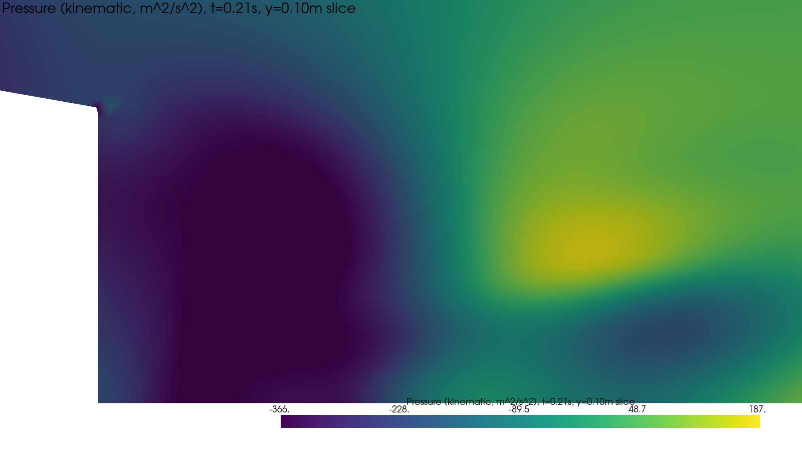
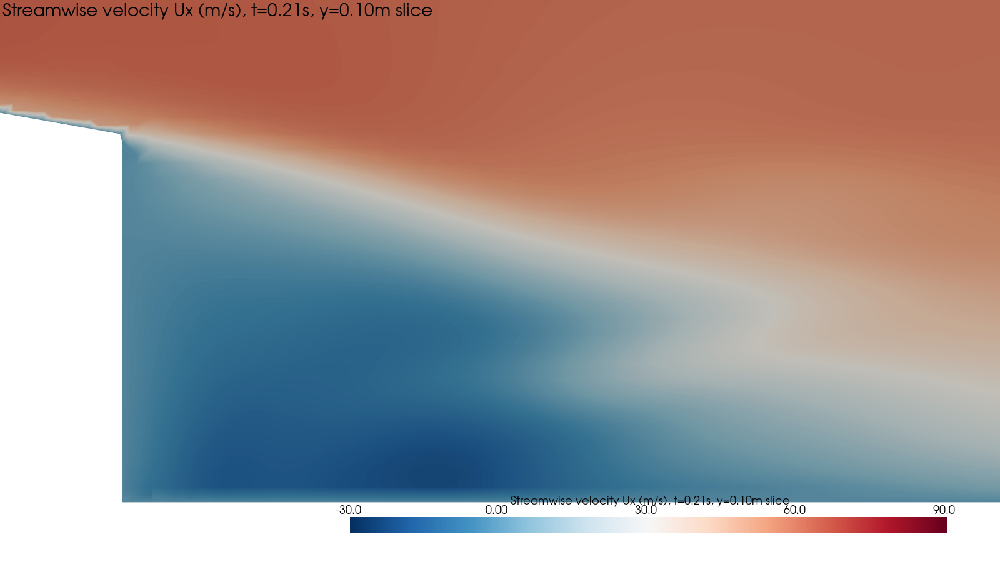

### Known issue, not yet fixed: `analyze_steady_cd.py`'s FFT assumes
### uniform sampling

`analyze_steady_cd.py`'s FFT step (`fft_analysis()`) computes a single
`dt = median(diff(t))` and calls `np.fft.rfftfreq(n, d=dt)` — valid
for the steady, iteration-indexed case it was written for (where
consecutive samples are exactly 1 iteration apart), **not valid** for
transient, time-indexed data where `adjustTimeStep` produces
non-uniformly-spaced samples. Run against 10°'s transient data, it
produced exactly the window-length-fraction artifact pattern already
documented for steady-case data at 0°/25° (Section 10.5/9.3) — every
top-ranked "peak" was a simple fraction of the window length, and the
script's own artifact-flagging check (comparing against
`window_length/denom` for denom 1–6) missed a 7th-ranked artifact at
denom=10 because that denominator isn't checked. This script's
FFT output must not be used on transient data until fixed (either by
resampling to a uniform grid before the FFT, as the docstring already
claims is guaranteed for steady data, or by restricting its use to
steady cases only). The windowed mean/std/sub-window-spread portions
of the same script do not depend on uniform sampling and remain valid
for transient use.

Separately, `load_forcecoeffs()` (duplicated across
`analyze_steady_cd.py`, `inspect_early_transient.py`, and
`estimate_period_peaks.py`) globs and concatenates all
`postProcessing/forces/*/forceCoeffs.dat` segments and drops only
exact-duplicate timestamps — it does not handle a segment that only
partially overlaps a later one (as occurred in 10°'s first 0.014 s of
restarts), which would silently double-count non-duplicate rows from
the superseded portion of an overlapping segment. This project's
10°-transient stitching was done by hand outside these scripts for
this reason; the scripts themselves have not been patched.

### New scripts developed for this case
- `scripts/visualize_burst_sequence.py` — multi-frame wake-evolution
  visualization from pre-sliced `cutPlaneSurface` VTK output (as
  opposed to `visualize_snapshot.py`'s reconstructed-3D-mesh
  approach), with a shared color scale computed across all requested
  frames (fixed range for Ux, wake-region-restricted percentile range
  for pressure) so frames are visually comparable.

### Decisions still open for 20°/30°/35°
- Whether to patch `analyze_steady_cd.py`'s FFT and/or
  `load_forcecoeffs()` before the next case, or continue working
  around them per-case.
- `resolveFeatureAngle` for future angles: re-derive per angle (as
  done here), rather than assume 90 continues to be appropriate,
  especially as slant angle increases toward and past the drag-crisis
  transition.

---

## 10.7. Case Matrix Progress — 20° Slant Angle (60 m/s)

*Same running-log style as Sections 10.5/10.6, not yet integrated into
the numbered structure above.*

**Case**: `slant20_re4.18M_symtest` (steady sanity check only — the
full 2000-iteration steady baseline was skipped entirely for this
angle, per an explicit decision, going further than Section 10.5's
"short sanity check" default for 0°/10°) and
`slant20_re4.18M_symtest_transient` (transient PIMPLE).

### Geometry
STL verified: 336 triangles, watertight, volume 111.3560 L — correctly
between the 10° body's 112.7976 L and the 25° body's 110.7653 L,
continuing the monotonic decreasing-volume trend with increasing
slant angle.

### Feature-angle investigation and `resolveFeatureAngle` decision

Following the Section 10.6 correction (`resolveFeatureAngle` and
`includedAngle` are different parameters; only the former acts on any
mesh in this project), the `includedAngle` sweep was run purely as a
geometric characterization tool, not as mesh configuration. Result:
`includedAngle 90` gives 9 edges (matching every other angle's plain
box-edge structure); the slant-to-rear separation edge appears between
`includedAngle 108` and `110` (confirmed via direct eMesh
point-coordinate inspection: a new transverse edge at z=0.212 m,
consistent with a 20° slant reducing the rear-face height further
than 10°'s z=0.24945 m) -- closely matching the geometric prediction
of ~90°+slant angle = 110°.

**Decision, made explicitly for this angle (option B, distinct from
0°/10°'s option A)**: `resolveFeatureAngle` was set to **70°**, aiming
to capture the slant-to-rear edge (predicted threshold ~180-109=71°,
via the confirmed source relationship). This was verified, not
assumed: the steady 20° mesh's `snappyHexMesh` log shows 3,103 cells
marked under `curvature/regions` (vs. 10°'s 2,607 at
`resolveFeatureAngle 90`), confirming the setting does fire on this
geometry. The exact spatial location of the marked cells (i.e.,
whether they are concentrated at the intended slant-to-rear edge or
elsewhere) was not independently confirmed via direct spatial
inspection -- a deferred diagnostic, not a resolved point.

**This is now a third distinct `resolveFeatureAngle` configuration
across the sweep** (0°/10°: 90°; 25°: 120°, fires on nothing; 20°:
70°, deliberately chosen to fire on an additional edge) -- each
independently justified for its own geometry, per this project's
standing no-transfer-assumed principle, but adding a third dimension
of cross-angle mesh difference to document as a limitation.

### Mesh

**Steady case**: level (6,7), `resolveFeatureAngle 70`, **2,282,758
cells**. `checkMesh`: Mesh OK -- max non-orthogonality **55.4°**
(noticeably higher than 0°'s 44.9° and 10°'s 44.6°, the first case in
this project where this metric is not similar in magnitude to its
predecessors -- no independent explanation established), max skewness
1.496, max aspect ratio 5.30.

**Transient case**, staged coarsening:

| Attempt | Level | `nCellsBetweenLevels` | Cells | Result |
|---|---|---|---|---|
| 1 | (5,6) | 3 | 1,176,428 | Mesh OK; not used (chosen for comparability with 0°/10°/25° at (4,5)) |
| 2 | (4,5) | 3 | 874,395 | Non-convergent castellation oscillation (71 shell-refinement iterations, 21-29 cells/pass) -- third confirmed instance of this failure mode in the project (also seen at 0° and 10°) |
| 3 (final) | (4,5) | **2** | **849,762** | Converged cleanly (7 iterations); `checkMesh` OK |

Final mesh quality: max aspect ratio **5.097** (notably *lower* than
0°'s 6.20 and 10°'s 6.195 at the same settings -- breaks what had
looked like an emerging pattern; not explained), max non-orthogonality
51.67°, max skewness **1.708** (the highest of any mesh in this
project to date). All values pass `meshQualityControls` thresholds.
Domain volume check (18.1506, matching the expected value) confirms
correct body placement.

### Steady RANS sanity check -- full baseline skipped

Per an explicit decision for this angle, the full 2000-iteration
steady baseline (as run for 0° and 25°) was skipped entirely; only
the short (~300-iteration) sanity check from Section 10.5's decision
was run. Ran cleanly to completion, no errors. Cd was still
monotonically decreasing through all 5 usable 50-iteration blocks
(0.176->0.169->0.163->0.161->0.160), not yet showing any sign of
flattening within 300 iterations, consistent with (but not
conclusively demonstrating) the same non-convergence pattern seen at
0°/10°/25°. **No steady-state Cd is reported for 20°.**

### Transient PIMPLE

`deltaT` computed from the actual finished mesh: finest cell 1.195 mm
(notably larger than 0°/10°'s ~1.003 mm, plausibly related to this
mesh's different `resolveFeatureAngle`-driven local refinement
structure, not independently confirmed), initial
`deltaT = 9.958e-06 s` at U=60 m/s, Co=0.5. `fvSolution`/`fvSchemes`
from 25°'s tight-tolerance transient values, matching the 10° case's
approach (no loosening decision was needed).

Run in a single stage, 0 -> 0.2 s, 8 cores: **71,227 s (~19.8 hours)**
wall-clock -- approximately 40% longer than 10°'s equivalent stage
(51,730 s) despite comparable mesh size and identical target time.
Cause not established (candidate factors: the larger finest-cell size
requiring more early adjustTimeStep cutback, or the higher mesh
skewness slowing pressure-solver convergence -- neither verified).

Data integrity: unlike 0° and 10°, this run produced **only one
`postProcessing/forces` segment** (no internal restart fragmentation),
simplifying analysis -- no stitching was required. One known-class
startup outlier (Cd~392 at t~1.18e-05 s) was identified and excluded,
consistent with the same early-transient spike seen at 0° and 10°.
Full record otherwise clean: 0 NaN, 0 duplicate timestamps, genuinely
monotonic (an initial monotonicity check falsely flagged a violation
due to an uninitialized-comparison bug in the ad-hoc verification
script, not a real data issue -- corrected and reconfirmed).

### Frequency/period result: inconclusive, with a new methodological
### finding on peak-detection prominence

Direct time-domain peak detection (`estimate_period_peaks.py`) over
t=0.1-0.2 s at the tool's default auto-scaled prominence threshold
produced a badly contaminated result: 28 "peaks," most clustered in
groups of 6-16 spaced only ~12 microseconds apart -- solver-timestep-
level numerical noise being misidentified as distinct oscillation
events, not a real signal (mean period 0.0032s, CoV 245%, nonsensical
St=1.52). **This is a new failure mode, distinct from the window-
length FFT artifact and the window-sensitivity issue already
documented for 0°/10°.**

A prominence sweep (0.0007 to 0.004, a 5.7x range) found a **stable
plateau of exactly 4 genuine peaks** at every tested value in that
range (t = 0.1135, 0.1249, 0.1592, 0.1791 s) -- confirming these are
real, robust local maxima, not threshold-dependent artifacts. Values
below this range recover noise; a value of 0.005 (initially tried)
over-suppressed and dropped two of the four genuine peaks, showing
the default auto-scaled threshold and a naively-chosen high threshold
can both fail, in opposite directions.

**Result**: 3 measured intervals (0.0115, 0.0343, 0.0199 s), mean
period 0.0219 s, **CoV 43%** -- too few and too irregular to
characterize a frequency, with one notably large gap (0.0343 s)
between peaks 2 and 3 that could indicate either genuine irregularity
(as found at 10°) or an unresolved intermediate cycle. **No Strouhal
number is reported for 20°.** Given the wall-clock cost of extending
this case (stage 1 alone took ~19.8 hours), the run was not extended;
this is documented as an inconclusive result at t=0.2s, the same
honest treatment given to 0°'s frequency finding, rather than forced
to a number.

### Flow-field visualization

An 8-frame sequence spanning the full analyzed window (t = 0.108,
0.113, 0.125, 0.148, 0.159, 0.173, 0.179, 0.194 s -- bracketing the 4
identified peaks and intervening troughs) was rendered at the same
y=0.10 m slice, same wake-restricted (x>0.9m) shared pressure color
scale established at 10°. Named `sequence` rather than `burst1`, since
this case's peak-detection did not resolve a clean, repeatable burst
cycle the way 10° did -- the naming avoids implying a mechanism that
was not established.

**Observation**: the wake pressure structure shows real, visible
frame-to-frame variation -- most notably a distinct isolated
high-pressure feature embedded in the wake at t=0.125s (closest
sampled frame to the second identified peak, t=0.1249s), not present
in most other frames. Streamwise velocity, unlike at 10° (where it
was frame-invariant), also shows a visible structural change at
t=0.125s and t=0.173s -- a pale intrusion into the otherwise uniform
freestream region above the shear layer, absent or much weaker in the
other 6 frames. **This correspondence is partial, not comprehensive**:
only 2 of the 4 identified force-signal peaks (t=0.113, 0.125, 0.159,
0.179) show visually distinctive structure in either field; t=0.113
and t=0.179 do not stand out visually the way t=0.125 does. The
visualization is reported as showing real unsteady wake structure,
not as confirming or explaining the (inconclusive) peak-detection
result.

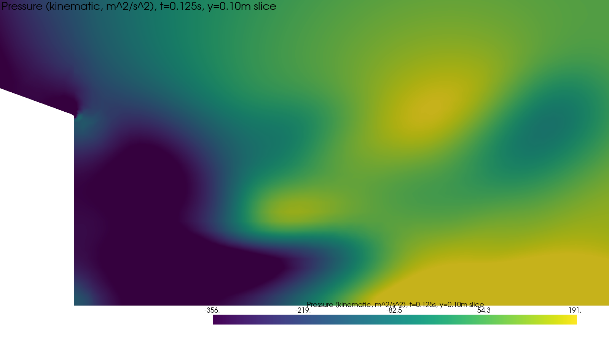
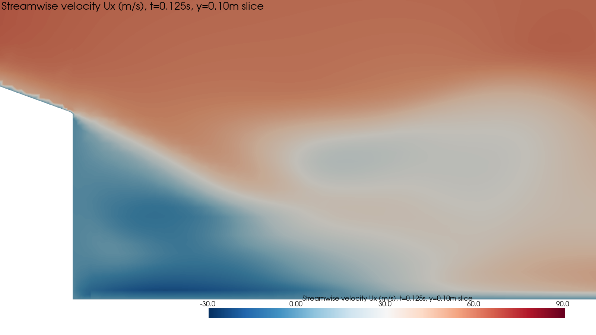

### New methodological finding: peak-detection prominence sensitivity

`estimate_period_peaks.py`'s default auto-scaled prominence (10% of
the window's Cd std) is not universally safe: at 20°, it caught
solver-timestep-level noise as spurious peaks, producing a
badly-wrong result (CoV 245%) that would have been reported as a
"measurement" without the sweep-and-cross-check applied here.
**Any future use of this tool should include a prominence sweep
across at least a 5x range before trusting a single-threshold
result**, the same discipline already established for FFT window
choice (Section 10.6) and window-start sensitivity (Section 10.6's
10° window check). The tool itself has not been modified to
auto-detect this failure mode; this remains a manual verification
step.

### Decisions still open for 30°/35°
- Whether `resolveFeatureAngle` should continue to be independently
  derived per angle (as done for 20°) as the sweep approaches and
  passes Ahmed's documented drag-crisis region, or whether a pattern
  will emerge that simplifies this.
- The unexplained mesh-quality metrics (20°'s uncharacteristically
  high non-orthogonality and skewness, its lower-than-expected aspect
  ratio) remain unexplained -- no case in the sweep has yet had its
  mesh quality maxima spatially located and inspected.
- Whether to formally add the prominence-sweep step into
  `estimate_period_peaks.py` itself (e.g., an automatic sweep-and-
  flag mode) rather than performing it manually per case.

## 10.8. Case Matrix Progress — 30° Slant Angle (60 m/s)

*Same running-log style as Sections 10.5-10.7, not yet integrated into
the numbered structure above.*

**Case**: `slant30_re4.18M_symtest` (steady mesh built and verified,
but NEVER RUN with the solver -- see below) and
`slant30_re4.18M_symtest_transient` (transient PIMPLE).

30° is the angle in this sweep closest to Ahmed's documented
drag-crisis transition region, making it the case where prior
assumptions (steady non-convergence, staged mesh coarsening,
resolveFeatureAngle transfer) are least safe to carry over without
checking.

### Geometry
STL verified: 336 triangles, watertight, volume 110.2861 L --
continuing the monotonic decreasing-volume trend
(114.44->112.80->111.36->110.77->110.29 L for 0/10/20/25/30deg).

### Feature-angle investigation and resolveFeatureAngle decision

Following the established diagnostic-only sweep methodology, the
slant-to-rear separation edge was found between includedAngle 119
and 120 (z=0.177 m -- continuing the trend of decreasing rear-face
height with slant angle: 0.288->0.24945->0.212->0.177 m for
0/10/20/30deg). The "~90+slant angle" heuristic again predicted the
transition closely (predicted 120, actual ~119.5).

**Decision (option C, user choice)**: resolveFeatureAngle was set to
**120°**, matching 25deg's value. This was independently verified, not
assumed to transfer: the steady mesh's snappyHexMesh log shows
curvature/regions: 0 cells marked across all iterations --
**confirming a specific prediction made in advance**, via the source
relationship (resolveFeatureAngle ~= 180 - includedAngle): this
body's slant-to-rear edge sits at a normal-angle difference of
~60.5deg, well below the 120deg firing threshold, so it was predicted
not to fire, and it did not. This matches 25deg's finding (zero
curvature refinement) and gives 25deg and 30deg -- the two closest
angles in the sweep -- a shared property no other angle pair has.

### Mesh

**Steady case**: level (6,7), resolveFeatureAngle 120,
**2,149,034 cells** -- the smallest steady mesh in the sweep.
checkMesh: Mesh OK -- max non-orthogonality **40.0°**, max skewness
**0.896**, max aspect ratio **4.11**. This is the best-quality steady
mesh in the sweep after 25deg on every metric. A weak, inconclusive
pattern is noted: both angles with zero curvature-driven refinement
(25deg, 30deg) have better mesh quality than the three angles with
nonzero curvature marking (0/10/20deg), but 30deg does not match
25deg's numbers closely enough to treat this as more than a loose
association -- not established as causal.

**Transient case**, staged coarsening:

| Attempt | Level | nCellsBetweenLevels | Cells | Result |
|---|---|---|---|---|
| 1 (final) | (5,6) | 3 | 1,121,804 | Mesh OK, 6 shell iterations (clean); curvature/regions confirmed 0 at this level too |

**Level (5,6) was KEPT for the transient mesh (option A, user
decision)** -- the first case in the sweep not stepped down to (4,5),
breaking consistency with 0/10/20/25deg. No castellation-oscillation
test at (4,5) was performed for this angle, since the coarsening step
was not taken. Final mesh quality: max aspect ratio **3.556** (best in
the sweep for any transient mesh), max non-orthogonality 40.0°
(identical to the steady mesh), max skewness 0.910. Domain volume
check (18.1511, matching the expected 18.1509) confirms correct body
placement.

### Steady RANS run: skipped entirely (not just shortened)

**User decision**: no solver run of any kind was performed on the
steady case -- not the full 2000-iteration baseline, not even the
short ~300-iteration sanity check used at every other angle. This
goes one step further than 20deg's decision (which skipped only the
full baseline). The steady mesh stands as a verified checkMesh-OK
artifact, never exercised with the solver. No sanity-check data exists
for this angle at any level.

### Transient PIMPLE

deltaT computed from the actual finished mesh: finest cell
**1.485 mm** (direct extent) -- larger than every (4,5)-level angle's
finest cell (0/10deg: ~1.003 mm; 20deg: 1.195 mm) despite this being a
nominally finer (5,6) surface level. Not fully explained; plausibly
related to the absence of curvature-driven local refinement at this
angle (also absent at 25deg, whose finest cell was not checked against
this hypothesis). Initial deltaT = 1.237504e-05 s at U=60 m/s,
Co=0.5. fvSolution/fvSchemes from 25deg's tight-tolerance
transient values, per the established approach.

Run in a single continuous stage, 0 -> 0.2 s directly (user
instruction -- no sanity check preceded it), 8 cores: **130,984 s
(~36.4 hours)** wall-clock -- the longest single stage in the sweep,
roughly 1.8x slower than 20deg and 2.5x slower than 10deg despite a
mesh size (1.12M cells) not proportionally larger. Cause not
established.

Data integrity: one internal restart occurred at t=0.047s (unlike
0/10deg's multiple early fragmented restarts, and unlike 20deg's zero
restarts). The solver log shows no anomaly at the restart point
(excellent residuals, stable Courant number, no error) -- the cause of
the restart itself is not established, but it does not appear to be a
solver-side problem. The two resulting segments (0 to 0.0476s,
0.047 to 0.2s) overlap by a small window and were truncated and
spliced (keeping the earlier segment only up to t<0.047s), the same
method already validated for 10deg's more complex multi-segment case.
One known-class startup outlier (Cd~352 at t~1.3e-05s) was identified
and excluded. Full record otherwise clean: 0 NaN, 0 duplicate
timestamps, genuinely monotonic after stitching.

### Frequency/period result: multi-scale fluctuation, no plateau found
### -- a new, distinct kind of inconclusive result

The coarse trend (t=0.06-0.2s window, chosen after the full 0-0.2s
record showed sharp early decay in the first ~0.03-0.04s) showed a
comparatively flat plateau with only modest wiggles -- visually the
most stable-looking coarse trend of any angle since 25deg. A windowed
sub-window-spread check gave 6.94% (tighter than 10deg's 9.5% over an
equivalent check, but well short of 25deg's reported cleanliness), with
a non-monotonic (rise-fall-partial-recovery) pattern across the 5
sub-windows -- real structure, not simple noise.

A prominence sweep across the peak-detection tool (0.0007 to 0.012,
learning directly from 20deg's methodological lesson) found **no
stable plateau at any tested value** -- peak count declined
continuously and smoothly from 11 down to 2 across the range, never
holding steady. Direct visual inspection of the signal (t=0.06-0.2s)
confirmed why: the Cd trace shows genuine structure at multiple
amplitude scales simultaneously -- a small secondary bump (~t=0.083),
a sharp large excursion (~t=0.093), a complex multi-wiggle trough
region (t=0.12-0.15) containing several small features that never
clear any tested threshold, and further peaks toward the end of the
window. **This is a fourth, distinct kind of inconclusive result in
the sweep**: 0deg showed monotonic decay with noise; 10deg showed
clean discrete burst-and-quiet amplitude modulation; 20deg showed
intermittent large-amplitude bursts against small background
fluctuation; **30deg shows continuous multi-scale fluctuation with no
clean amplitude separation between "noise" and "signal" at all.**

**No Strouhal number is reported for 30deg.** Given the signal's
demonstrated lack of a single characteristic amplitude scale, no
single-threshold peak count or period estimate is defensible. This
qualitative difference in wake character, occurring at the angle
closest to the drag-crisis region, is noted as a plausible (but
unconfirmed) genuine physical signature -- not established as such,
since the same result could in principle arise from numerical
sensitivity at this mesh/level combination, which has not been
independently tested against a (4,5)-level rerun.

Cd/Cl statistics over t=0.06-0.2s (n=16,188; caveated as spanning a
non-simple, multi-scale fluctuating signal, not a settled window): Cd
mean 0.1629, std 0.0057; Cl mean 0.7615, std 0.0067.

### Flow-field visualization

An 8-frame sequence was rendered at the 6 detected peak times plus 2
additional points sampling the small secondary bump and the deep
multi-wiggle trough region (t = 0.071, 0.083, 0.093, 0.108, 0.132,
0.148, 0.165, 0.194 s), same y=0.10 m slice and wake-restricted
pressure color scale as 10deg/20deg.

**Observation, the most notable finding of this case**: unlike 10deg
and especially 20deg, **the wake pressure and velocity fields are
nearly frame-invariant across this entire sequence.** The pressure
lobe's shape, size, and position are visually almost identical in all
8 frames, with only subtle shifts in a small internal bright spot;
velocity contours are even more consistent, with the shear layer and
recirculation-eye position essentially unchanged throughout.
Wake-region numeric statistics confirm this: p mean 9.4-12.6, std
80-90; Ux mean 55.3-55.6 across all 8 frames -- the tightest
frame-to-frame numeric spread of any angle visualized in this sweep.

**This directly contradicts the expectation set by the frequency
analysis.** Given the demonstrated multi-scale force-signal
fluctuation, a correspondingly visible change in wake structure was
expected (as partially seen at 20deg); instead, the single y=0.10m
slice shows almost no visible response. Two explanations are
possible and NOT distinguished by this data: (1) the force
fluctuation's physical origin lies outside what this single 2D slice
can capture (a 3D, spanwise, or differently-located phenomenon), or
(2) the fluctuation is real but subtle at the flow-field level despite
being significant in the integrated force coefficient. This is
reported as an open, genuine finding, not resolved one way or the
other.

**Separate observation**: whole-slice pressure minimum reaches
approximately -4,500 to -4,600 at this slice (front-nose region,
excluded from the wake-restricted analysis) -- substantially more
extreme than 10deg/20deg's approximately -2,760 to -2,810. This
suggests the front-nose pressure singularity may intensify with
increasing slant angle, though this is based on only three data
points (10, 20, 30deg) and has not been checked against 0deg or 25deg.

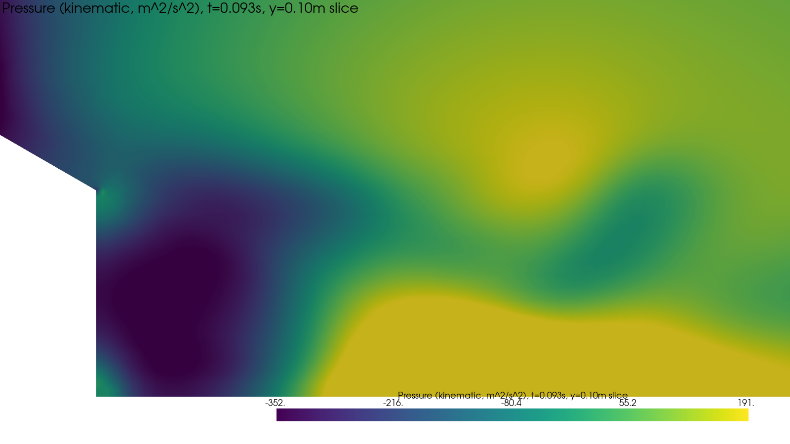
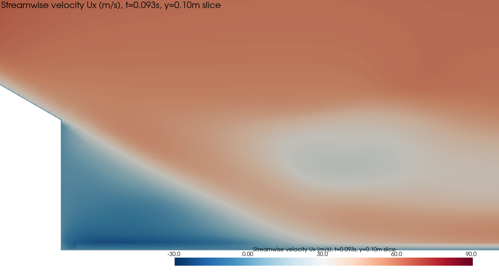

### Decisions still open for 35°
- Whether to run a (4,5)-level rerun of 30deg as a mesh-sensitivity
  check, given the case was never tested at that level and the
  multi-scale frequency finding's numerical-vs-physical origin is
  unresolved.
- Whether the near-frame-invariant flow field despite an irregular
  force signal is specific to this slice location (y=0.10m) or would
  also appear at a different y-slice or spanwise-averaged view --
  not investigated.
- The front-nose pressure-extremity trend with slant angle (10:
  -2760 -> 20: -2810 -> 30: -4500ish) is noted but not confirmed
  against 0deg/25deg.
- Whether 35deg, being further past the drag-crisis region than 30deg,
  should default to a full steady baseline (option C from 30deg's
  computational plan) to actually test Decision 9's premise, given
  that every angle skipping this check so far has not produced
  a clear answer to "does this regime actually behave differently."

## 10.9. Case Matrix Progress — 35° Slant Angle (60 m/s)

*Same running-log style as Sections 10.5-10.8, not yet integrated into
the numbered structure above.*

**Case**: `slant35_re4.18M_symtest` (steady mesh built and verified, but
NEVER RUN with the solver) and `slant35_re4.18M_symtest_transient`
(transient PIMPLE, two stages: 0 -> 0.2 s, then 0.2 -> 0.3 s).

35° is the largest slant angle in the sweep. It follows 30° in
approach (no steady solver run, option A) but differs in two ways:
the transient mesh was stepped down to level (4,5) (user decision,
against the recommendation to match 30°'s (5,6)), and the run was
extended from 0.2 s to 0.3 s after the 0.2 s analysis showed the
near-stationary part of the record was too short.

### Geometry
STL verified: 336 triangles, watertight (0 open edges), bounds
x in [0, 1.044], y in [-0.1945, 0.1945], z in [0, 0.288] m, volume
**109.9330 L** -- completing the monotonic six-angle sequence
(114.44 -> 112.80 -> 111.36 -> 110.77 -> 110.29 -> 109.93 L for
0/10/20/25/30/35°).

### Feature-angle investigation and resolveFeatureAngle decision

The diagnostic includedAngle sweep was run in a scratch case outside
the repository. **A methodological error was found and corrected
during this sweep.** The first detector counted eMesh points near the
predicted slant-to-rear edge height (x = 1.044, z ~ 0.1607 m) and
reported the edge present at every angle from 115 to 130. Those
points were in fact the top endpoints of the vertical rear-face side
edges, which are selected at any includedAngle above ~90°. The
detector was replaced by a connectivity-based one (an eMesh edge whose
two endpoints lie on opposite sides of the symmetry plane at
x = 1.044, z ~ 0.1607). With it, the slant-to-rear edge first appears
between includedAngle **124 and 125** (at 124 the edge count is one
below the point count, at 125 it equals it, i.e. the rear-face outline
closes). The "~90+slant angle" heuristic predicted 125, so it holds at
35° to within 1°. The corresponding normal-angle difference is
~55-56° (180 - 124.5).

**Not rechecked**: the 10°/20°/30° sweeps were done earlier and have
NOT been re-verified with the connectivity-based detector. If any of
them used a point-count criterion like the discarded one, their quoted
transition values could be affected. The z-heights of the edge
(0.288 -> 0.24945 -> 0.212 -> 0.177 -> 0.1607 m) follow directly from
the geometry and are not in question.

**Decision (option C, user choice)**: resolveFeatureAngle **120°**,
matching 25° and 30°. A prediction was made before building: 0 cells
marked, since ~55-56° is far below 120°. **Confirmed**:
curvature/regions marked 0 cells in all 9 passes of the steady build
and in all 7 passes of the transient build. This is the second time
the 180 - includedAngle relationship was used to predict the mesh
log in advance and held.

### Mesh

**Steady case**: level (6,7), resolveFeatureAngle 120,
**2,141,344 cells** (smallest steady mesh in the sweep; built in 264 s).
checkMesh: Mesh OK -- max non-orthogonality **40.0041°**, max skewness
**0.896019**, max aspect ratio **4.10996**. These maxima are
essentially identical to 30°'s (40.0°, 0.896, 4.11) despite ~8,000
fewer cells and a different geometry. Where the worst cells sit was
not investigated; a plausible (untested) reading is that they lie in a
region the slant angle does not affect.

**Transient case**:

| Attempt | Level | nCellsBetweenLevels | Cells | Result |
|---|---|---|---|---|
| 1 (final) | (4,5) | 3 | 844,113 | Mesh OK; 6 shell iterations, converged cleanly; curvature/regions 0 |

**Level (4,5) was chosen (user decision B)** for comparability with
0/10/20/25°. The castellation oscillation seen at 0/10/20° with
nCellsBetweenLevels 3 (about 70 iterations, ~21-29 cells selected per
pass, never converging) did **not** recur: the shell loop went
158,579 -> 242,355 -> 792,016 -> 876,961 -> 877,087 cells and
iteration 5 selected 0 cells; the final snapped mesh has 844,113
cells (73 s build). So no nCellsBetweenLevels 2 fix was needed. Only
25° and 35° have been clean at this setting at (4,5); no cause is
established and two cases do not make a pattern.
Final mesh quality: max aspect ratio **3.45921**, max
non-orthogonality **39.3308°** (average 4.60324), max skewness
**0.868806** -- the best of any transient mesh in the sweep on all
three metrics.

### Steady RANS run: skipped entirely (option A, same as 30°)

No solver run of any kind was performed on the steady case. The
steady mesh stands as a checkMesh-OK artifact never exercised with the
solver. This leaves unanswered whether the steady-non-convergence
premise holds for angles past the drag-crisis region (see the
limitations carried forward below). [Resolved 2026-10-11: the scope
statement is in Section 8.0 and the 35° list below; the steady premise was
never tested.]

### Transient PIMPLE

deltaT computed from the finished mesh: finest cell **3.215 mm**
(direct extent; minimum cell volume 5.646157e-08 m^3, cube-root
3.836 mm), initial deltaT = **2.679167e-05 s** at U = 60 m/s, Co = 0.5.
This is 2.7-3.2x larger than at 10° (1.003 mm) and 20° (1.195 mm) at
the same (4,5) level and a similar cell count (844k vs ~848-850k).
It is consistent with doubling 30°'s (5,6) value (2 x 1.485 mm =
2.97 mm) when stepping down one level. Hypothesis, not tested: the
~1 mm cells at 0/10/20° came from curvature-driven refinement
(nonzero marking at those angles; zero at 25/30/35°). **Consequence**:
at similar cell counts, 35° has coarser local resolution near the body
and a ~3x coarser time step than 0/10/20°, which limits how directly
those angles can be compared. 25°'s finest cell was not checked.
fvSolution/fvSchemes are 30°'s (25°'s tight-tolerance transient
values); the controlDict differs from 30°'s only in deltaT (and, after
stage 2, endTime). purgeWrite 2 with the wake probe and y = 0.10 m
cutPlaneSurface function objects, as at 10/20/30°.

**Stage 1 (0 -> 0.2 s)**: launched 2026-09-30 10:02:53, 8 cores,
11,107 steps, **24,564 s (~6.8 h)** wall-clock, finished cleanly (no
errors; final Courant max 0.493, final deltaT 1.81818e-05, last-step
initial residuals ~1e-5 to 1e-3, continuity errors ~1e-12 or lower).
Much faster than 30° (36.4 h) and 20° (19.8 h); cause not
established (the larger deltaT is a candidate, untested). One
forceCoeffs segment, no restarts.

**Stage 2 (0.2 -> 0.3 s)**: added by user decision after the stage-1
analysis (see below). Restart from latestTime with endTime 0.3;
deltaT carried over from the time directory (first step t = 0.200018,
after one step of 1.81818e-05). Launched 2026-10-01 02:06:34,
5,458 steps, **11,635 s (~3.2 h)**, finished cleanly (final Courant
max 0.492, final deltaT 1.85185e-05). Seam checks: the two t = 0.2
rows in the two forceCoeffs segments are identical in every column
(max abs difference 0), so the restart reproduced the stage-1 end
state exactly; the wake-probe seam is clean (0.199873 -> 0.2 ->
0.200055, no overlap or gap; probes are sampled at time-step indices
that are multiples of 10).

**Data integrity**: stitched record = segment 0 (t < 0.2, startup
outlier removed) + segment 0.2 in full: 16,565 rows, t = 0 to 0.3,
strictly monotonic, 0 duplicates, 0 NaN. The startup outlier at
t = 2.63158e-05 s (Cd 174.2, Cl 20.6, Cm -28.7) was excluded from
analysis (raw data untouched); the next row (t = 3.7e-05, Cd 0.469) is
still startup transient and lies outside every analysis window.

### Stationarity and Cd/Cl statistics

Block statistics show the startup transient ends at ~0.04 s (block Cd
std drops from ~0.007 to ~0.002). On the 0-0.2 s record alone, **no
window was stationary**: drift over window / std = 2.15 (start 0.06),
2.16 (0.08), 1.69 (0.10), 1.78 (0.12), 1.10 (0.14). The slice
statistics (below) flattened only from ~0.147 s, leaving ~0.05-0.07 s
of near-stationary data and 3 robust force peaks (2 intervals). That
is why the run was extended to 0.3 s (user decision).

On the full 0-0.3 s record, drift/std by window start (all ending at
0.30): 2.01 (0.06), 1.36 (0.10), **0.43 (0.14), 0.50 (0.18),
0.47 (0.20), 0.02 (0.22)**. Windows starting at 0.14 or later have
drift smaller than their own fluctuation, for the first time in this
case. Fluctuation amplitude stays intermittent in stage 2 (block
std 0.00082-0.00351, a 4.3x range). Primary window **0.14-0.30**
(chosen on two independent grounds: slice statistics flat from ~0.147
and drift/std < 1), sensitivity windows 0.18-0.30 and 0.10-0.30.

| Window | n | Cd mean | Cd std | Cl mean | Cl std |
|---|---|---|---|---|---|
| 0.14-0.30 (primary) | 8,725 | **0.15890** | 0.00300 | **0.71462** | 0.00255 |
| 0.18-0.30 | 6,557 | 0.15851 | 0.00278 | 0.71461 | 0.00243 |

Across window starts 0.14-0.22 the Cd mean varies by 0.0004 (0.25%)
and the Cl mean by 0.0003. Sub-window spread (same definition as
`analyze_steady_cd.py`: max - min of sub-window means as a percentage
of the overall mean): 1.69% over 0.14-0.30 with 5 equal-count
sub-windows (means 0.16063, 0.15817, 0.15833, 0.15795, 0.15944; the
first is still slightly high, i.e. residual relaxation to ~0.17 s),
1.45% with 4 equal-time sub-windows, and 1.15% over 0.18-0.30. On the
30° window (0.06-0.20, 5 sub-windows) 35° gives 4.21% against 30°'s
6.94%, with means falling monotonically (0.16485 -> 0.15802), i.e.
relaxation. These spreads are variability of the mean between chunks
of the record, **not confidence intervals** (the samples are
autocorrelated and no effective sample size was estimated). Cd means
should not be compared across angles without the caveats of differing
window, stationarity and mesh level; a consolidated comparison belongs
in the final limitations pass. [Resolved 2026-10-11: no cross-angle
comparison is made; Section 8.0 states that the sweep Cd values are not
comparable across angles (E1, E2, E4).]

### Frequency/period result: criterion not met, no Strouhal number

Pre-stated criteria (fixed before the 0-0.3 s peak analysis): a
plateau in the prominence sweep counts only if the peak count is
unchanged across >= 3 consecutive sweep values spanning >= 2x; a
Strouhal number is reported only if the plateau also survives the
sensitivity windows and an independent signal (the wake probe)
corroborates it, defined as Cd and at least one probe signal each
having a top-3 Lomb-Scargle peak at >= 5x the 10-100 Hz band-median
power within +-10% of the same frequency, in both windows.

*0-0.2 s record (stage 1)*: a 5-peak plateau (t = 0.0912, 0.1165,
0.1470, 0.1709, 0.1914 s) over prominence 0.003-0.008 (2.7x), with
irregular intervals (25.3, 30.4, 23.9, 20.5 ms; CoV 14%; would be
St 0.192) from only 4 intervals. The wake probe did not corroborate
it (irregular spacing, CoV 24-59%, no stable counts). Inconclusive.

*0-0.3 s record, window 0.14-0.30*: prominence sweep 0.0003-0.012
(40x) gave 12, 12, 10, 10, 9, 9, 9, 8, 7, 6, 4, 2, 1 peaks. The
plateau criterion is met only at its minimum: 9 peaks at prominence
0.0015-0.003 (exactly 2.0x; true width between 2x and 4x), then a
continuous decline. The 9 peaks (t = 0.1470, 0.1709, 0.1914, 0.2036,
0.2230, 0.2379, 0.2572, 0.2704, 0.2904 s) are window-stable (at
prominence 0.002, window 0.18-0.30 returns exactly the 7 of them
inside it; window 0.10-0.30 returns them plus 0.1165). Mean interval
17.9 ms (CoV 21%; would be St 0.268 if all peaks are counted), but
the intervals alternate short and long from ~0.19 s (12.2, 19.4, 14.9,
19.3, 13.2, 20.0 ms).

*Lomb-Scargle spectra (valid for non-uniform steps; the FFT in
`analyze_steady_cd.py` is not, see Section 10.6, and remains
unpatched)*, 0.16 s window => ~6 Hz resolution; "x" = power / band
median, a rough indicator and not a significance test:

| Component | Window 0.18-0.30 | Window 0.14-0.30 | Criterion |
|---|---|---|---|
| ~60 Hz (St ~0.29) | Cd 60.5 Hz #1 x13.1; p-probe 60.0 #1 x12.2; Uz 59.5 #2 x12.6; Ux 59.5 #3 x5.9 | Cd 60.0 Hz #1 **x4.7**; p-probe 57.0 #2 x6.5; Uz 57.0 #2 x5.6; Ux 57.5 #3 x4.5 | **Not met**: Cd x4.7 < 5 in the longer window (frequency agrees within 5%) |
| ~90 Hz (St ~0.43) | Cd 90.5 #2 x5.3; p-probe 91.0 only #4 x2.7 | Cd 91.0 #2 x4.1; p-probe 90.5 only #4 x3.5 | Not met |
| ~30 Hz (St ~0.15) | Cd 29.0 #3 x4.4 | not in Cd top 4 | Not met |

**Result: the pre-stated corroboration criterion is not met (a narrow
miss at ~60 Hz), so no Strouhal number is reported for 35°.** The
threshold was not relaxed after seeing the data.

Observations made after seeing the data, therefore **hypotheses, not
results**: (1) The peaks that survive the highest thresholds
(0.1914, 0.2230, 0.2572, 0.2904 s) are spaced 31.6, 34.2, 33.2 ms
(CoV 3.2%, St 0.1455) with a smaller peak between each pair, which
would fit a ~30 Hz cycle with a strong second harmonic (60 Hz) and a
weaker third (~91 Hz); Ux and Uy probes show strong ~33 Hz peaks
(x13 and x9 in the shorter window), but Cd does not. With ~6 Hz
resolution, three peaks near multiples of 30 Hz can align by chance.
(2) The pressure-probe peaks (8 peaks at 0.5-1.0 x std, mean spacing
17.6 ms, CoV 17%) precede the nearest force peaks by 2.3-8.8 ms in
8 of 8 cases (paired by eye, not computed), which would indicate a
stable phase relation; it was not quantified. (3) An unexplained
~21-23 Hz component (St ~0.10-0.11) is the strongest line in the
probe velocities (Ux x85-88, Uz x28-41, Uy x8-19) and appears in Cl
(22.0 and 20.5 Hz); a 0.16 s window holds only ~3.5 cycles of it, and
slow relaxation not removed by the linear detrend could leak into it.
Candidate frequencies are listed here as candidates; none is
reported as this case's shedding frequency.

### Flow-field visualization

A 16-frame sequence (t = 0.091, 0.102, 0.117, 0.131, 0.147, 0.155,
0.171, 0.191, 0.204, 0.215, 0.223, 0.238, 0.257, 0.27, 0.275, 0.29 s;
force-peak times, a weak peak, and quiet-block times) was rendered at
the y = 0.10 m slice with **one shared scale for all 16 frames**:
wake-restricted pressure (-293.73, 175.47) and Ux (-30, 90). Files:
`results/slant35_re4.18M_transient/all_frames/`.

*Relaxation phase (0.091-~0.147 s)*: frame-to-frame differences are
dominated by a monotonic relaxation, not by isolated events. RMS
deviation of the wake field from the 8-frame mean (first eight
frames): pressure 18.40, 12.34, 10.06, 11.95, 10.21, 10.62, 6.82,
7.16; Ux largest at t = 0.091 (1.252, against 0.58-0.86 for the
rest). The near-ground minimum Ux (lowest slice row, z = 0.010 m;
wall-function dependent, usable as a trend only) goes from
-25.22 m/s at x = 1.148 (t = 0.091) to about -15 m/s at x ~ 1.25
(t = 0.171-0.191); wake-mean Ux falls from 56.13 to 55.80 and is flat
from ~0.147.

*Stationary window (0.204-0.29 s, 8 frames)*: two predictions were
stated before the check and both held: pressure RMS deviation
5.18-6.61 (predicted ~5-12), Ux RMS deviation 0.440-0.627 (predicted
0.4-1.0), max/min ratio 1.28 (pressure) and 1.42 (Ux) (predicted
< 2), no monotonic time trend. **The slice is nearly frame-invariant
once the flow has relaxed** (deviations ~8-10% of the wake pressure
spread, ~4-5% of the Ux spread), as at 30°. Wake-mean Ux 55.72-55.81,
std 12.21-12.35. The near-ground minimum Ux nevertheless varies from
-16.1 to -21.1 m/s at x = 1.20-1.24 (a stable location, quantized to
mesh nodes). Post-hoc and unconfirmed: the minimum is most negative
at the three large force-peak frames (-18.7, -20.5, -21.1; mean
-20.10), intermediate at three small-peak frames (mean -18.23) and
weakest at two quiet frames (mean -16.59); n = 3, 3, 2 on a single
near-wall point.

*Correction of a visual reading*: on first inspection embedded
low-pressure features seemed to appear only at t = 0.102 and 0.155,
the two weakest force peaks. The RMS-deviation test did not support
this (0.155: 10.62, mid-pack; 0.102: 12.34 against 11.95 at the quiet
frame 0.131). It is recorded as a visual observation not
quantitatively confirmed; whole-wake RMS could miss a small localized
feature, so absence in this metric is not proof of absence.

**The 30° question remains open at 35°**: a single 2D slice shows very
little of the force fluctuation (Cd std 0.0025-0.003, ~1.6-1.9% of the
mean). Whether the fluctuation lives outside this slice (3D or
spanwise) or is subtle at field level was not distinguished.

Separate observation: whole-slice pressure minimum (front-nose region)
is about -3,757 to -3,913 in the frames inspected, **less extreme than
30°'s ~-4,500 to -4,600** and more extreme than 10°/20°'s
~-2,760 to -2,810. The nose-pressure intensification with slant angle
suggested at 30° therefore does not continue; 0° and 25° were never
checked, so no monotonic trend can be claimed.

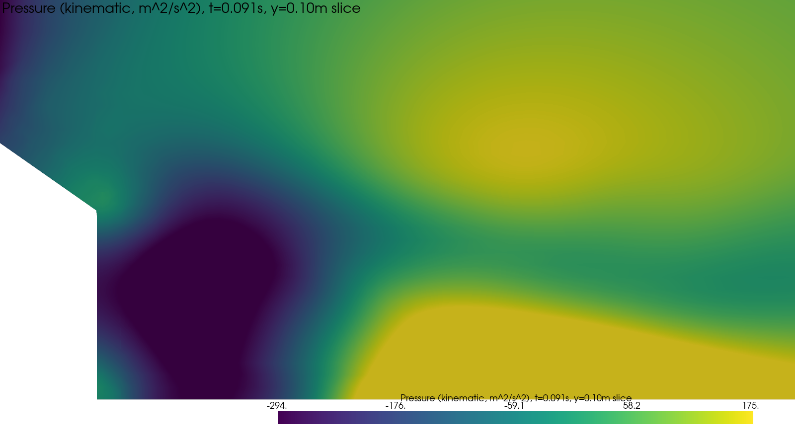
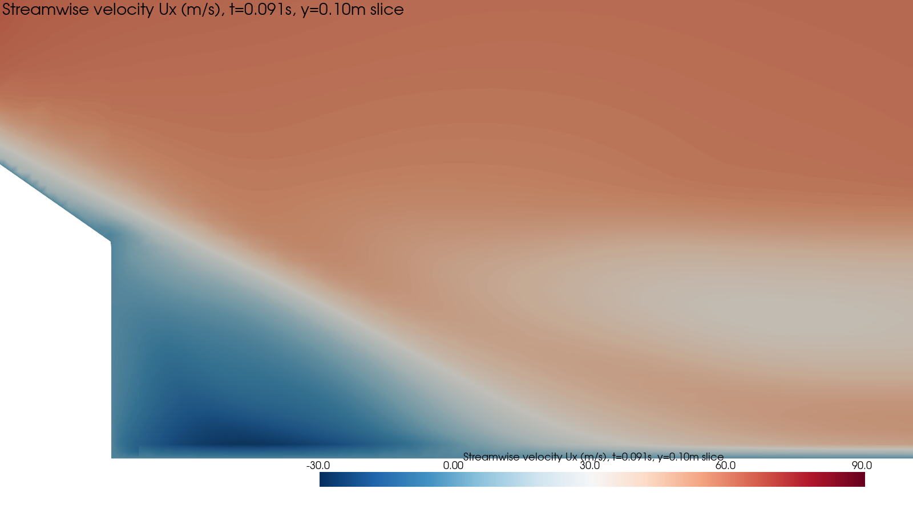
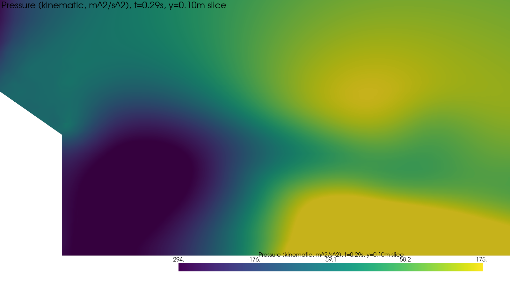
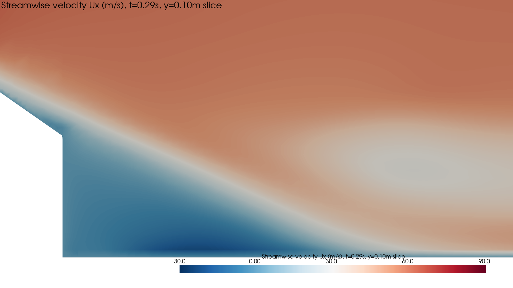

### Resolution of the open items listed at the end of Section 10.8
- 30° (4,5) mesh-sensitivity rerun: not performed (outside the locked
  scope). 35° at (4,5) does not substitute for it (different angle).
- Whether the frame-invariant wake is specific to the y = 0.10 m
  slice: still not investigated.
- Nose-pressure trend with slant angle: 35° does not continue it (see
  above); 0° and 25° unchecked.
- Full steady baseline for 35°: not run (option A). The question
  whether steady non-convergence holds past the drag-crisis region is
  unanswered. The transient record reaching a near-stationary state
  only after ~0.14 s does not test steady-solver behaviour.

### Reproducibility notes for this case
**Updated 2026-10-11.** The 35° stitching, stationarity, Lomb-Scargle/probe and
frame RMS-deviation analyses were first run as inline Python. They are now saved as
`scripts/stitch_force_segments.py`, `stationarity_report.py`,
`spectral_probe_check.py` and `slice_frame_deviation.py`, and the stitched record is
regenerated from the raw `postProcessing` segments (the original `/tmp` copies no
longer exist). Each script was run against the numbers published for this case:

- *Stitching*: 16,565 rows, t = 0-0.3 s, strictly increasing, 0 duplicates, 0 NaN; the
  startup outlier (t = 2.63158e-05 s) dropped; the two t = 0.2 rows identical.
- *Stationarity*: all published drift/std values, window means and standard deviations,
  and the 5- and 4-sub-window spreads reproduced. The published 1.15 % for window
  0.18-0.30 is the 4 equal-time sub-window spread.
- *Lomb-Scargle*: all published peaks, ranks and x-values reproduced (linear detrend,
  grid 0.5-150 Hz in 0.5 Hz steps, peaks ranked inside the 10-100 Hz band, which the
  published ranks require; the band rule is inferred), and the verdict (corroboration
  criterion not met). One match not listed in the table above also exists: Cd 90.5 Hz
  with Uy 90.0 Hz in window 0.18-0.30; it does not change the verdict, because in
  window 0.14-0.30 both Cd (x4.1) and Uy (x3.6) are below 5.
- *Frame deviation*: the near-ground minima (row z = 0.01044 m) and the whole-slice
  pressure minima are reproduced exactly; the pressure and Ux RMS deviations are
  reproduced to within about 3 % and the wake-mean Ux is about 0.05 m/s below the values
  quoted above. The wake region is not defined in this README, so the script uses an
  inferred rectangle (x 1.044-6.264 m, z 0-0.8 m, wall row included); the agreement is
  approximate, not exact.
- *Not reproduced*: the "block" Cd standard deviations (0.00082-0.00351 above). The block
  size was not recorded, so that number rests on the original inline analysis only.

Existing scripts reused: `compute_transient_deltat.py`,
`inspect_early_transient.py`, `estimate_period_peaks.py` (run from a
cleaned scratch copy of the force record), `visualize_burst_sequence.py`
(unmodified).

### Limitations specific to 35° (cross-angle and validation caveats are in Section 8.0; this list is the 35°-specific detail)
- No steady solver run; no steady baseline.
- Transient mesh level (4,5) differs from 30° (5,6); finest cell and
  deltaT differ ~2.7-3.2x from the 0/10/20° (4,5) meshes.
- Cd non-stationary before ~0.17 s; reported mean is over 0.14-0.30
  with the stated spread, not a confidence interval.
- No Strouhal number; criterion narrowly missed; post-hoc observations
  untested.
- Single y = 0.10 m slice and single wake probe.
- Feature-angle sweeps for 10/20/30° not re-verified with the
  corrected detector.

## 10.10. Validation Case — 25° Slant, 50 mm Clearance, Compared with ERCOFTAC AC1-05 (added 2026-10-10)

*This section is the first and only quantitative comparison with experimental
data in this project. It concerns one new case family (`cases/val25_clr50_*`),
not the sweep above: the sweep cases remain subject to errata E1–E4.*

### Purpose and scope

The question was whether the corrected setup (25° slant, 50 mm ground
clearance, half-body reference area 0.056016 m², inlet turbulence matched to
the experiment) reproduces the measured flow behind and over the slant of the
Ahmed body. Criteria C1–C5 were fixed before any run (see the table below).
The comparison data are ERCOFTAC Classic Collection AC1-05, Experiment 2
(LDA, 40 m/s, symmetry plane y = 0; test data page
https://kbwiki.ercoftac.org/w/index.php/Test_Data_AC1-05). The raw data are not
in this repository, and no figure here shows measured points, because the
ERCOFTAC data terms have not been checked. Only pass/fail outcomes, pooled
error metrics and qualitative statements are reported.

### Cases

| case | U∞ [m/s] | Re_L | nose Tu, νt/ν (design → sampled in the solution) | inlet k0, ω0 |
|---|---|---|---|---|
| `val25_clr50_40ms` (**headline**) | 40 | 2.784e6 | 0.25 %, 10 → 0.253 %, 10.09 | 0.027751, 176.1 |
| `val25_clr50_60ms` | 60 | 4.176e6 | 0.25 %, 10 → 0.255 %, 10.09 | 0.1051, 639.8 |
| `val25_clr50_40ms_tu05` (**sensitivity test**) | 40 | 2.784e6 | 0.5 %, 20 → 0.522 %, 20.35 | 0.52657, 1475.3 |

- Geometry: the frozen 25° STL (z = 0.05 … 0.338 m, i.e. 50 mm clearance), half
  domain with a symmetry plane at y = 0, body frontal area used as Aref = 0.056016 m²
  (half of 0.112032 m²), so the coefficients below equal full-body coefficients.
- Mesh: snappyHexMesh, levels (6,7), nCellsBetweenLevels 3, uniform wake box at
  level 3, 2,725,204 cells; checkMesh passes (max aspect ratio 3.42, max
  non-orthogonality 32.9°, average 7.85°, max skewness 0.953 — the highest in
  the project, never located). The mesh is the same for all three cases (the
  `polyMesh` files are byte-identical).
- Solver: OpenFOAM 11 `foamRun`/`incompressibleFluid`, steady SIMPLEC, k–ω SST with
  `nutkWallFunction` at walls, numerical settings copied from the frozen 25° case,
  8 MPI ranks, 2000 iterations. Mean fields (U, p, k and second moments) are
  iteration-averaged by `fieldAverage` over iterations 1001–2000.
- Inlet turbulence: set from the free-stream SST decay relation
  (β = 0.0828, β* = 0.09) so that the nose has the target Tu and νt/ν; the values in
  the table were checked by sampling the converged fields near the nose
  (`scripts/validation/check_nose_turbulence.py`).
- **tu05 changes two variables at once** (turbulence intensity and viscosity
  ratio, because a nose Tu of 0.5 % is not reachable at ratio 10 with this decay
  relation at 40 m/s). Any difference to the baseline therefore cannot be
  attributed to one of them.
- Run history (provenance): the baseline stage 1 was stopped at iteration 312 to free
  CPU cores and continued (313–1000); the tu05 stage 1 was interrupted at iteration 90
  and resumed from the iteration-50 write (so the log of iterations 1–90 was
  overwritten; the force history of that segment survives). Stage 2 (1001–2000,
  with `fieldAverage`) ran without interruption in all cases. Force histories were
  stitched from the restart segments, later segments winning on overlaps; gaps: none.

### Convergence and stationarity

Pre-stated criterion for the averaging window: drift/std of Cd below 0.5 and 4-window
spread of the window mean below 2 %. The criterion was calibrated on the baseline's
own stage-1 history, where it first holds for windows starting at iteration 700.

| case | Cd mean (1000–2000) | Cd std | Cl mean | Cl std | drift/std | 4-window spread |
|---|---|---|---|---|---|---|
| 40 m/s | 0.28672 | 0.00308 | 0.32051 | 0.07547 | 0.118 | 0.095 % |
| 60 m/s | 0.28864 | 0.00295 | 0.31823 | 0.07457 | 0.00 | 0.02 % |
| 40 m/s, tu05 | 0.29500 | 0.00291 | 0.32633 | 0.07326 | 0.016 | 0.059 % |

All three pass. The residuals do **not** reach the 1e-4 target: in the baseline the
final U_z residual is of order 2e-2, and the Cl histories oscillate in a limit
cycle (std ≈ 0.07 in all cases, period not measured; this is an oscillation in the iteration count of the steady solver, not a physical frequency). The means above are means
over that oscillation, not converged steady values. The residual histories of the
60 m/s and tu05 cases were not separately examined for this section.

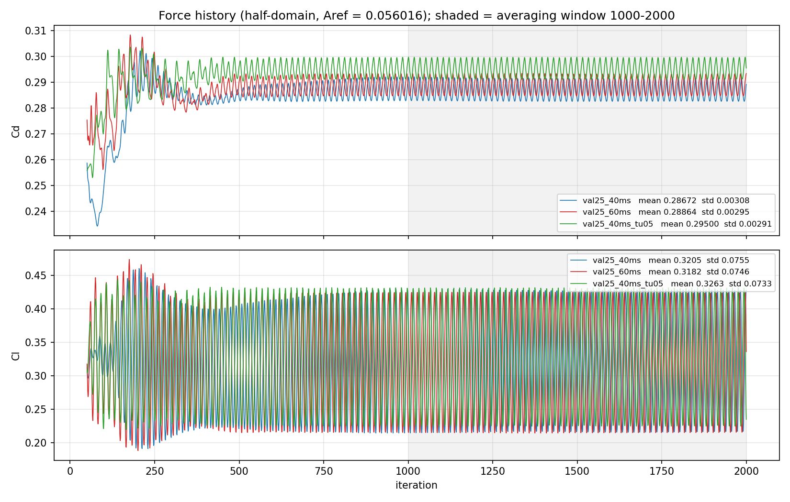

### Pre-stated criteria and results

| id | criterion | baseline (0.25 %) | tu05 (0.5 %) |
|---|---|---|---|
| C1 | full-body Cd vs Experiment 1 (Ahmed 1984, 60 m/s): ≤10 % agree, 10–20 % partial, >20 % disagree | **no verdict** (corrected 2026-10-10, see below) | n/a |
| C2 | no reversed flow above the slant at the measured stations | pass | pass |
| C3a | reversed flow at the wake stations 38, 88, 138 mm | pass | pass |
| C3b | recirculation end inside 138–288 mm | pass: ends in (188, 238] mm | pass: same interval |
| C4 | NRMSE/Ub of U and W over slant + wake points: ≤0.05 good, 0.05–0.10 fair, >0.10 poor | 0.1020, **poor** (n = 562) | 0.0960, **fair** |
| C5 | upstream floor layer, modelled k: report only | see text | see text |

- **C1: no pass/fail verdict (corrected 2026-10-10; the earlier text said the paper had
  not been obtained).** Ahmed et al. (1984), SAE 840300, was obtained. It prints the drag
  coefficient Cw only at 0° (0.250), about 12.5° (0.230) and 30° (0.378 high-drag,
  0.260 low-drag) in its Fig. 4. **No 25° value is printed**, and the numeric reference
  area F is not stated. Two graph readings (approximate, read by eye from the figures,
  not printed values) disagree with each other: Fig. 4 gives Cw ≈ 0.285 at 25° (±0.005);
  Fig. 15(e), a second drag-versus-slant curve (0.272 at 0°, 0.33 at 30°), gives about
  0.25 at 25°. The paper does not explain the difference. Against these, the computed
  60 m/s Cd of 0.2886 is about +1 % (Fig. 4) or about +15 % (Fig. 15e); the 40 m/s value
  0.2867 is about +1 % and +15 %. The pre-stated bands would therefore give "agree" or
  "partial" depending on which figure is trusted, so **no verdict is assigned**.
  The comparison is further limited because the experiment used stilts with a tare
  correction and an open test section (our CFD has neither), F is not stated, and the
  experiment is at Re 4.29e6 against our 4.18e6 at 60 m/s. A close total Cd would not
  by itself indicate a correct flow field: the slant boundary layer is not reproduced
  (C4 slant-only, poor).
- C4 split: slant only 0.1852 (baseline, poor) and 0.1698 (tu05, poor), n = 112; wake only 0.0667
  and 0.0659 (both fair), n = 450. The baseline→tu05 change of the pooled value
  (poor → fair) is a small change of about 0.006 that crosses the 0.10
  threshold; it carries no uncertainty estimate (no mesh or wall-treatment
  sensitivity exists), and it should not be read as a validated improvement.
  The slant-only value is poor in both cases.
- The headline case remains the pre-registered baseline. tu05 is reported as a
  sensitivity test and does not replace it.
- C5 (report only): in the baseline, the modelled turbulence kinetic energy in the
  upstream floor layer and in the free stream was far below the level implied by
  the measurement. tu05 raises it to the same order, but the free-stream level stays
  below the measurement-implied one. The upstream floor-layer velocity error
  changes little between the cases.

### What agrees and what does not

Agrees: no reversed flow above the slant and a recirculation behind the base whose
extent falls in the measured interval (C2, C3). Does not agree: the velocity
profiles over the slant. In the baseline the CFD boundary layer over the slant is
thinner and much fuller than measured, with the divergence beginning between the
x = −163 mm and −143 mm stations (x measured from the rear base). tu05 reduces
the profile error at all ten slant stations, by 4–11 % of the baseline error, but
the layer stays far too full. The discrepancy therefore is not removed by the
free-stream turbulence change tested here.

### CFD-only slant-layer diagnostic (iteration-averaged U [m/s] above the slant surface)

| station x [mm] | case | +1 mm | +5 mm | +10 mm | +15 mm | +20 mm | +30 mm |
|---|---|---|---|---|---|---|---|
| −143 | baseline | 21.6 | 28.0 | 37.3 | 42.4 | 44.0 | 44.9 |
| −143 | tu05 | 20.1 | 26.3 | 35.3 | 40.9 | 43.0 | 44.9 |
| −103 | baseline | 17.6 | 24.3 | 32.0 | 36.7 | 39.5 | 41.6 |
| −103 | tu05 | 15.8 | 22.2 | 29.7 | 34.7 | 38.1 | 41.2 |
| −63 | baseline | 15.7 | 21.4 | 28.5 | 34.8 | 37.7 | 40.2 |
| −63 | tu05 | 13.6 | 18.9 | 25.9 | 32.6 | 36.1 | 39.7 |
| −23 | baseline | 15.1 | 20.3 | 28.0 | 31.4 | 35.0 | 38.6 |
| −23 | tu05 | 12.5 | 17.4 | 25.0 | 28.7 | 32.9 | 37.8 |
| −3 | baseline | 15.6 | 19.1 | 25.0 | 30.8 | 33.8 | 37.8 |
| −3 | tu05 | 12.6 | 16.0 | 21.8 | 27.8 | 31.4 | 36.8 |

- About 10–11 distinct cells span the first 30 mm above the slant.
- Slant wall-function y+ (baseline / tu05): min 17.9 / 16.5, median 43.8 / 42.6, max
  116.5 / 115.9; 73.3 % / 72.7 % of slant faces in the 30–300 band, 26.7 % / 27.3 %
  below 30, none above 300. About a quarter of the slant wall-adjacent cells
  therefore sit below the usual wall-function range.

### Drag decomposition (CFD only, pressure drag by region, Cd on Aref = 0.056016 m²)

| region | 40 m/s | 60 m/s | 40 m/s tu05 | 60−40 | tu05−40 |
|---|---|---|---|---|---|
| front (x<0.10) | -0.01432 | -0.01171 | -0.01005 | +0.00261 | +0.00427 |
| mid (0.10..slant) | 0.00041 | 0.00041 | 0.00040 | +0.00000 | -0.00001 |
| slant | 0.14571 | 0.14456 | 0.14442 | -0.00115 | -0.00129 |
| base (rear face) | 0.10656 | 0.10672 | 0.10818 | +0.00016 | +0.00162 |
| other (x>slant) | 0.00142 | 0.00142 | 0.00139 | +0.00000 | -0.00003 |
| pressure total | 0.23979 | 0.24140 | 0.24434 | +0.00161 | +0.00455 |
| friction (by difference) | 0.04693 | 0.04724 | 0.05066 | +0.00031 | +0.00373 |
| Cd total (forceCoeffs, 1000–2000 mean) | 0.28672 | 0.28864 | 0.29500 | +0.00192 | +0.00828 |

"Friction" is the residual (total minus integrated pressure), not an integrated
shear stress. At the baseline the slant carries about half of Cd, the base about
37 % and friction about 16 %.

### Flow fields

Same view (symmetry plane, y = 0.5 mm), same colour limits in every case.
Cp = 2·p̄/U∞² with the outlet pressure as reference. The fields are
cell-centred and interpolated to points, so the coarse upstream mesh appears
blocky.

| | Cp | U_x/U∞ |
|---|---|---|
| 40 m/s |  |  |
| 60 m/s | 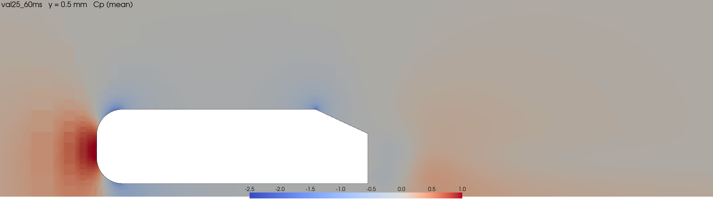 | 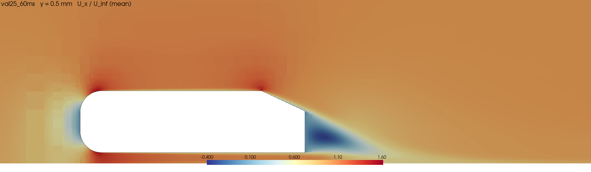 |
| 40 m/s, tu05 |  |  |

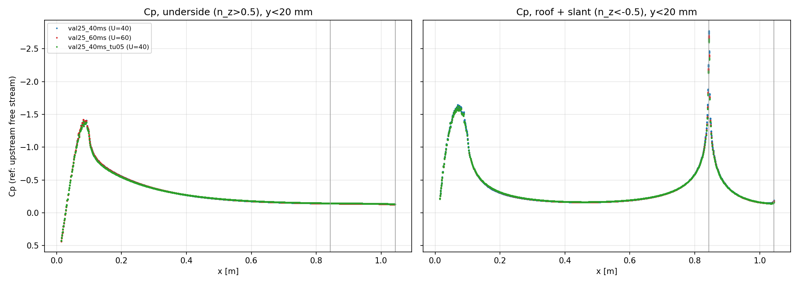

The three cases are nearly indistinguishable in these views (root-mean-square
difference of the normalised 40/60 m/s slices: U_x/U∞ 0.022, Cp 0.0028). The
suction spike at the roof/slant edge (Cp near −2.7) sits at a geometric edge and
its height depends on local mesh resolution; no mesh study was done, so it carries
no quantitative claim.

### Physical interpretation

- The wake topology — a single recirculation bubble behind the base ending in the
  measured interval — is reproduced; the slant boundary layer is not (too thin
  and too full), so the model does not capture the slant-layer state that
  feeds the separation at the base.
- 40 → 60 m/s changes Cd by +0.67 % and Cl by −0.71 %, with the largest change in the
  pressure drag of the front region and a slightly lower slant contribution.
- The Cd increase with tu05 (+0.00828) is split between pressure
  (+0.00455, nearly all of it in the front region) and the friction residual
  (+0.00373); slant and base nearly offset each other. It is not a
  separation-driven change. **Hypothesis, not tested:** higher turbulence
  intensity and viscosity ratio change the boundary-layer development on the nose
  rounding, which weakens the suction there (the minimum slice Cp is −2.338 for
  tu05 against −2.450 for the baseline).

### Engineering conclusions

- The model reproduces the position and extent of the recirculation behind this
  25° Ahmed body; it should not be used for slant-layer or separation-onset
  predictions without further work.
- The accuracy of the computed drag is **not established** (corrected 2026-10-10): the reference Cw at 25° is available only as a graph reading, the paper's two drag curves disagree at 25°, and the experiment included stilts and tare correction that the CFD does not model.
- A change of inlet turbulence from 0.25 % to 0.5 % (with the viscosity ratio from
  10 to 20) changes Cd by a few percent but does not repair the slant layer.

### Limitations and untested hypotheses

- No mesh-independence or wall-treatment study (by project decision), so model
  error cannot be separated from numerical error; the C4 numbers carry no
  uncertainty estimate.
- Steady RANS with k–ω SST and wall functions; about a quarter of the slant
  wall-adjacent cells have y+ below 30. Whether wall resolution, the RANS/SST
  model, or both cause the thin, full slant layer is **untested**.
- The inlet turbulence is set from an analytic decay relation, and the fields at
  the nose differ slightly from the design values (0.522 % against 0.5 %).
- tu05 changes two variables together.
- Residuals are not converged (limit-cycle); the means average over the oscillation.
- Only the y = 0 plane files were used. Other planes, the rear-body wall pressure
  and the near-wall hot-wire data of Experiment 2 were not used.
- The numerical domain (blockage 2.57 %) does not model the 3/4-open test section of
  the experiment, and the effect of the lateral and top boundary treatment was not tested.
- No stilts are modelled.
- Experiment 1 (drag, 60 m/s, Re 4.29e6) differs from the computed 60 m/s case
  (Re 4.176e6), and its reference area is not known to be the one used here.

### Reproducibility

Directories: `cases/val25_clr50_mesh` (mesh, built from the frozen 25° STL),
`cases/val25_clr50_40ms`, `_60ms`, `_40ms_tu05` (same mesh, inlet values in
`0/include/initialConditions`). Stage 1 uses `endTime 1000`; stage 2 adds the
`fieldAverage1` block and `endTime 2000` (`startFrom latestTime`). Analysis scripts
are in `scripts/validation/`: `check_nose_turbulence.py`,
`sample_ercoftac_y0.py` (requires the ERCOFTAC files, which are not in the repository),
`diagnose_slant_layer.py`, `visualize_validation_slices.py`,
`plot_centreline_cp.py`, `plot_force_history.py`. A driver,
`scripts/validation/run_validation_case.sh` (added 2026-10-11), runs the whole chain
for one case in a fresh directory outside the repository: `blockMesh`,
`snappyHexMesh -overwrite`, `checkMesh`, `decomposePar`, stage 1, stage 2 and
`reconstructPar -latestTime`. OpenFOAM 11 must be sourced, the work directory must not
exist, and the case uses 8 ranks:
scripts/validation/run_validation_case.sh cases/val25_clr50_40ms ~/work/val25_40ms

**Verification (2026-10-11, 40 m/s case only).** Rebuilt from the tracked files with the
driver (stage 1 and stage 2, about 4.8 h wall time on 8 ranks including meshing), the
mesh was byte-identical to the committed mesh case (md5 of `points`, `faces`, `owner`,
`neighbour`; 2,725,204 cells). Over iterations 1000-2000, Cd = 0.28672 (std 0.00308) and
Cl = 0.32051 (std 0.07547) matched the original run to the printed digits, with
stationarity statistics drift/std -0.118 and 4-window spread 0.095 %. The two force
histories are not bit-identical: the largest pointwise difference over 1000-2000 is
7.5e-5 in Cd and 3.9e-4 in Cl, and the differences shrink to about 1e-6 by iteration 1500.

**Limits of this verification.** The 60 m/s and Tu 0.5 % cases were not re-run with the
driver (they differ from the verified case only in `0/include/initialConditions`). The
original stage-1 `controlDict` was not saved, so the driver derives stage 1 from the
tracked stage-2 file (`endTime 1000`, `fieldAverage1` removed); the original 40 m/s
stage 1 was run in two pieces after a manual stop at iteration 312, whereas the driver
runs it in one. "Reproduced" here means the same mesh and the same window statistics, not
identical iteration histories (restart files are written with 6 significant digits). The
driver was first checked with a short smoke test (`--mesh-from`, `--stage1-end 50`,
`--stage2-end 100`).

## 11. References
- Ahmed, S.R., Ramm, G., Faltin, G. (1984). *Some Salient Features of
  the Time-Averaged Ground Vehicle Wake.* SAE Technical Paper 840300.
  https://doi.org/10.4271/840300
- Lienhart, H., Becker, S. (2003). *Flow and Turbulence Structure in
  the Wake of a Simplified Car Model.* SAE Technical Paper 2003-01-0656.
  https://doi.org/10.4271/2003-01-0656
- Lienhart, H., Stoots, C., Becker, S. (2000). *Flow and Turbulence
  Structures in the Wake of a Simplified Car Model (Ahmed Model).* DGLR
  Fach-Symposium, Stuttgart. (Source of the ERCOFTAC Experiment 2 data;
  title as printed on the ERCOFTAC page, not independently checked.)
- ERCOFTAC Classic Collection, Application Challenge AC1-05 "Ahmed body",
  (c) copyright ERCOFTAC 2004.
  https://kbwiki.ercoftac.org/w/index.php/Test_Data_AC1-05 (accessed
  2026-10-11). The measured data are not redistributed in this repository.
- Thacker, A., Aubrun, S., Leroy, A., Devinant, P. (2013). *Experimental
  characterization of flow unsteadiness in the centerline plane of an Ahmed
  body rear slant.* Experiments in Fluids 54, 1479.
  https://doi.org/10.1007/s00348-013-1479-5 (Cited in E5. Replaces an earlier
  "Thacker et al. (2010)" entry that could not be verified.)
