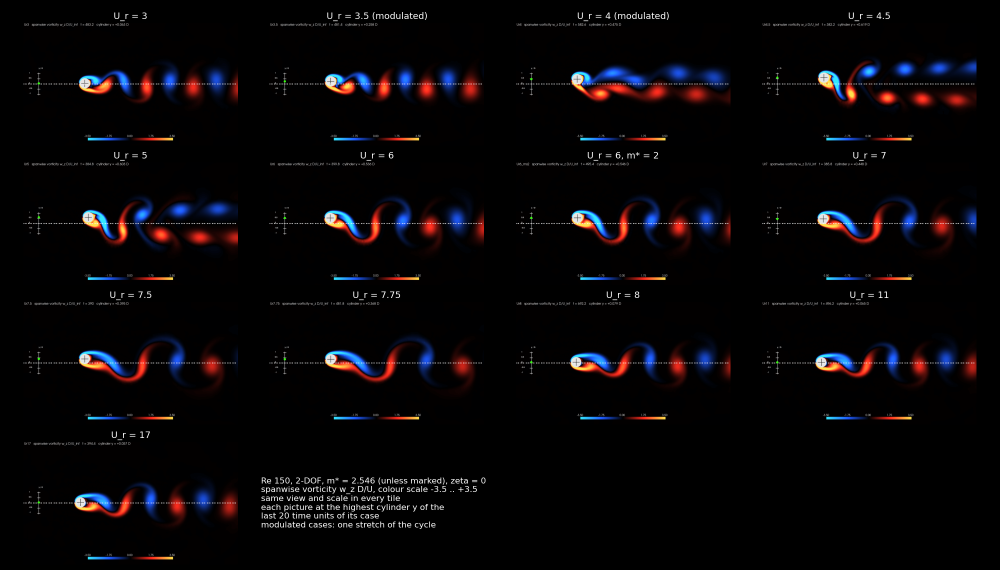
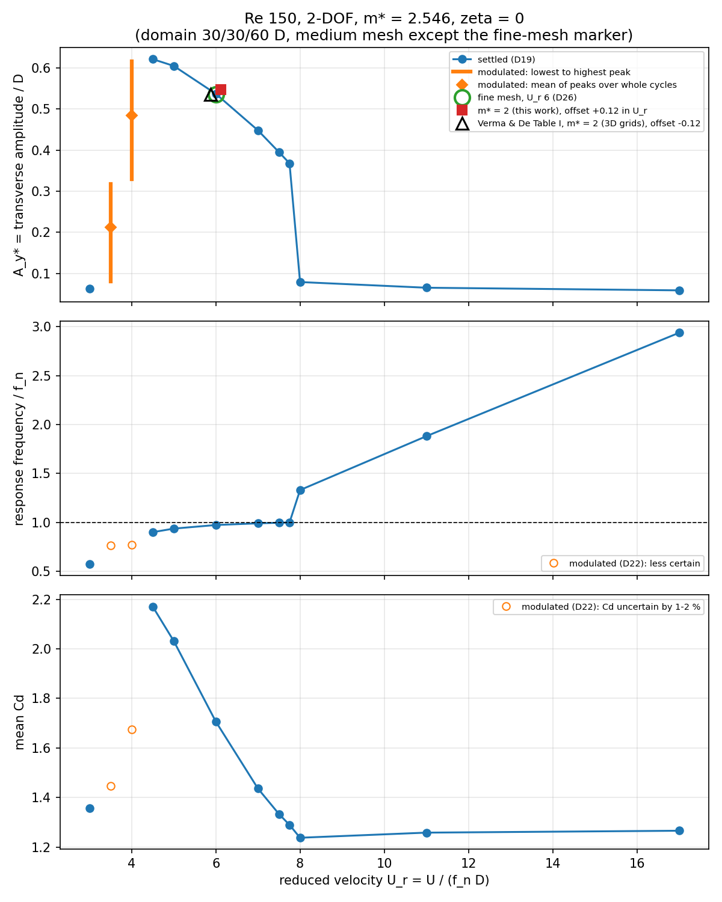
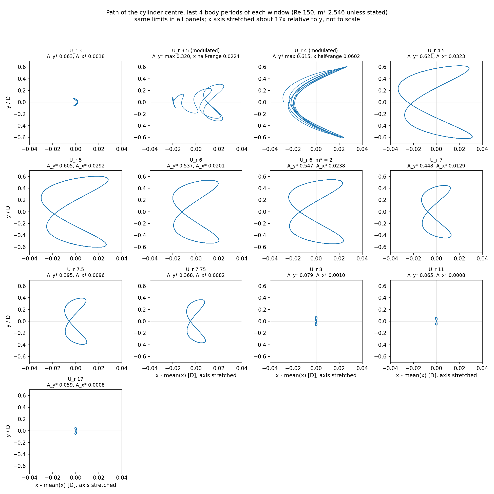

# Project 02: Circular cylinder, vortex shedding and vortex-induced vibration (OpenFOAM 11)

Part of the CFD Portfolio. **Status: completed**, with the limitations listed below.

A circular cylinder at Re = 150 is studied in two settings: held fixed, and mounted on a spring that lets it
move in the cross-flow and in-line directions (two degrees of freedom). The fixed cylinder is checked against
published data. The elastically mounted cylinder is swept over reduced velocity to find where the vortex
shedding locks onto the motion of the cylinder, and how large the oscillation becomes.

## At a glance

- **Fixed cylinder.** The Strouhal number agrees with the Williamson (1989) experimental fit to +1.7 % at
  Re = 100 and +1.4 % at Re = 150, inside the 2 % band fixed before any reference value was read. The mean
  drag coefficient at Re = 150 agrees with the Henderson (1995) two-dimensional simulations to +0.3 % on the
  baseline domain and -1.2 % on the production domain (band 3 %; a code-to-code comparison).
- **Elastically mounted cylinder.** Twelve reduced velocities from 3 to 17 (mass ratio 2.546, no damping).
  Lock-in is found for 4.5 <= U_r <= 7.75: the response frequency stays between 0.90 and 1.00 of the natural
  frequency and the transverse amplitude reaches 0.62 D. At U_r = 8 the amplitude collapses to 0.08 D and the
  frequency jumps to 1.33 of the natural frequency.
- **Numerical uncertainty of the amplitude** at U_r = 6: domain size +0.24 %, mesh -0.24 %, time step
  -0.02 % (an indicative sum of 0.5 %).
- **Comparison with the reference study** (Verma and De, three-dimensional): the amplitude at U_r = 6 for
  mass ratio 2 is within 2 % of the value tabulated for their finest grid. This value, and the definitions of
  mass ratio and reduced velocity, were taken from a summary of the paper and not checked against the PDF
  itself (see Limitations).

## Problem and question

A cylinder in a cross-flow sheds vortices alternately from its two sides. When the cylinder can move and the
shedding frequency approaches the natural frequency of its mounting, the cylinder vibrates strongly and the
wake locks onto the motion (lock-in). This vortex-induced vibration loads slender structures such as risers,
cables, chimneys and heat-exchanger tubes.

Question: does OpenFOAM 11 reproduce (a) the shedding of a fixed cylinder (Strouhal number, mean drag, rms
lift) and (b) the lock-in range and the amplitude response of an elastically mounted cylinder over a range of
reduced velocity?

Hypothesis, recorded before any run: lock-in occurs around U_r = 1/St (about 6), with the response frequency
following the natural frequency over a range of U_r. The width of the range and the peak amplitude were not
predicted.

## Approach

Two-dimensional, laminar, incompressible flow solved with OpenFOAM 11 (foamRun, incompressibleFluid) on a
moving mesh. The cylinder is a rigid body on an isotropic linear spring without damping (sixDoFRigidBodyMotion,
Newmark integration, PIMPLE with 3 outer correctors). Meshes are generated with Gmsh (structured quad boundary
layer, refined wake, one cell in the span direction). All quantities are non-dimensionalised with D = U = 1.

| Parameter | Value |
|---|---|
| Reynolds number | 150 (fixed cylinder also at 100) |
| Mass ratio m* | 2.546 (one check at 2) |
| Damping ratio | 0 |
| Natural frequency | equal in both directions, f_n = 1 / U_r |
| Reduced velocity U_r = U / (f_n D) | 3 to 17, twelve values |
| Time step | 0.0025 (D/U) |
| Sweep domain and mesh | 30 D upstream, 60 D downstream, 30 D to each side; medium mesh of 31,288 cells |

Full set-up (equations, boundary conditions, schemes, definitions): [docs/method.md](docs/method.md).

## Results

### Fixed cylinder

| Re | St (CFD) | St (Williamson 1989 fit) | Difference | Band | Verdict |
|---|---|---|---|---|---|
| 100 | 0.16717 | 0.16434 | +1.73 % | 2.0 % | PASS |
| 150 | 0.18603 | 0.18342 | +1.42 % | 2.0 % | PASS |

The mean drag coefficient is 1.357 at Re = 100 and 1.338 at Re = 150, and the rms lift coefficient 0.230 and
0.361. The lift has no reference and is reported without a verdict.

### Elastically mounted cylinder: response against reduced velocity

| U_r | A_y* | f / f_n | A_x* | Phase | Mean C_D | C_L rms |
|---|---|---|---|---|---|---|
| 3 | 0.063 | 0.574 | 0.0018 | about 0 deg | 1.357 | 0.525 |
| 3.5 (modulated) | 0.08 to 0.32 | 0.767 | | within +-4 deg | 1.446 | 0.931 |
| 4 (modulated) | 0.33 to 0.62 | 0.769 | | within +-4 deg | 1.675 | 1.346 |
| 4.5 | 0.621 | 0.900 | 0.0323 | about 0 deg | 2.171 | 0.653 |
| 5 | 0.605 | 0.937 | 0.0292 | about 0 deg | 2.032 | 0.335 |
| 6 | 0.537 | 0.973 | 0.0201 | about 0 deg | 1.706 | 0.090 |
| 7 | 0.448 | 0.990 | 0.0129 | about 0 deg | 1.436 | 0.021 |
| 7.5 | 0.395 | 0.996 | 0.0096 | not resolved | 1.333 | 0.008 |
| 7.75 | 0.368 | 0.999 | 0.0082 | not resolved | 1.289 | 0.005 |
| 8 | 0.079 | 1.331 | 0.0010 | about 180 deg | 1.237 | 0.106 |
| 11 | 0.065 | 1.881 | 0.0008 | about 180 deg | 1.258 | 0.154 |
| 17 | 0.059 | 2.938 | 0.0008 | about 180 deg | 1.266 | 0.174 |
| 6 (m* = 2) | 0.547 | 0.964 | 0.0238 | about 0 deg | 1.703 | 0.096 |

A_y* and A_x* are (max - min)/2 of the displacement over whole periods of a settled window, in units of D.
Phase is that between the total lift force and the displacement (positive: lift leads). The two modulated cases
do not settle: their amplitude varies periodically (about 150 time units at U_r = 4), so the table gives the
range of the envelope and mean values over one stretch of the modulation. The physical or numerical origin of
the modulation was not tested.

### Path of the cylinder

Inside lock-in the centre of the cylinder traces a closed figure-eight: it oscillates once per cycle across the
flow and twice per cycle along it (more than 93 % of the in-line amplitude is at twice the response
frequency). The in-line amplitude is only about 4 % of the transverse one at U_r = 6. At U_r = 3 the path is a
crescent, at U_r = 8 to 17 a very small figure-eight. The horizontal axis is stretched about 17 times.

### Flow visualisation

Vorticity pictures (one per case, taken at the top of the swing, same view and colour scale for all cases)
are collected in the grid at the top of this page. Pressure and velocity pictures for every case are in
`results/figures/<case>/`; the grid of pressure pictures is
[results/comparisons/pressure_grid.png](results/comparisons/pressure_grid.png). Videos of the vorticity over
20 time units, for seven regimes:
[U_r 3](results/videos/Ur3_vorticity.mp4),
[3.5](results/videos/Ur3.5_vorticity.mp4),
[4.5](results/videos/Ur4.5_vorticity.mp4),
[6](results/videos/Ur6_vorticity.mp4),
[7.75](results/videos/Ur7.75_vorticity.mp4),
[8](results/videos/Ur8_vorticity.mp4),
[17](results/videos/Ur17_vorticity.mp4).

## Physical interpretation

- **Lock-in.** For 4.5 <= U_r <= 7.75 the response frequency lies between 0.90 and 1.00 of the natural
  frequency and approaches it as U_r increases (0.900 at 4.5, 0.999 at 7.75). The amplitude is largest at
  the low end (0.62 D at U_r of 4 to 4.5) and decreases as the frequency ratio approaches 1. The lock-in range
  found this way is wider than the 5 to 7 quoted for the reference study, whose definition of the range is not
  known here; the comparison is also two-dimensional against three-dimensional.
- **Mean drag grows with the amplitude.** The mean drag coefficient is 2.17 at U_r = 4.5, against 1.34 for the
  fixed cylinder, and falls back with the amplitude (1.24 at U_r = 8). This is an observation of the data; no
  separate mechanism was tested.
- **End of the branch.** Between U_r = 7.75 and 8 the amplitude drops by a factor of 4.6 and the frequency
  jumps from 0.129 to 0.166. The transition lies between two computed points and was not resolved further; a
  hysteresis was not tested.
- **Phase.** The total force is in phase with the displacement (0 deg) below f / f_n = 1 and in antiphase
  (180 deg) above it. With no damping a settled oscillation takes no net energy from the flow, so the force
  component in quadrature with the displacement must vanish and the phase can only be 0 or 180 deg. The phase
  change therefore follows the crossing of f / f_n through 1 and adds no information beyond the frequency. Near
  f / f_n = 1 the net force tends to zero and the phase is not resolved (U_r = 7.5 and 7.75). It is the total
  force, not the vortex force.
- **Wake.** In the vorticity pictures the wake consists of alternating single vortices, one of each sign per
  cycle (consistent with the pattern called 2S); inside lock-in they lie far above and below the centreline.
  One snapshot of the near wake cannot establish a wake mode, and no classification is claimed. At U_r = 4
  the vorticity is smeared and no statement is made.
- **Outside lock-in.** At U_r = 8, 11 and 17 the cylinder oscillates at 0.166 to 0.173, below the shedding
  frequency of the fixed cylinder (0.186) and with an amplitude of about 0.06 D. The reason was not investigated.

What this means to an engineer: for a lightly damped body of this mass ratio the response is largest where the
shedding frequency falls below the natural frequency (U_r from 4 to 5), reaches about 0.6 D (more than half a
diameter), and the mean drag is then about 60 % above the fixed-cylinder value. Damping is zero here, so the
amplitudes are an upper bound for this mass ratio in two-dimensional flow, not a design prediction.

## Numerical verification

All tables and the discussion are in
[docs/fixed-cylinder-verification.md](docs/fixed-cylinder-verification.md). In brief, for the fixed cylinder
(percent of the finer value; mesh medium to fine, last halving of the time step, domain size):

| Re | Quantity | Mesh | Time step | Domain | Sum |
|---|---|---|---|---|---|
| 100 | St | 0.070 | 0.019 | 0.950 | 1.04 |
| 100 | Mean C_D | 0.092 | 0.067 | 1.088 | 1.25 |
| 150 | St | 0.109 | 0.039 | 1.343 | 1.49 |
| 150 | Mean C_D | 0.303 | 0.094 | 1.983 | 2.38 |

The domain size is the largest numerical term, with the upstream extent the largest single effect. The lift is
not mesh-converged at either Reynolds number (1.6 % medium to fine at Re = 100, 2.2 % at Re = 150). The time-step
error converges more slowly than second order, for a reason not established.

For the coupled problem:

- **Integrator.** An explicit (symplectic) integrator diverged in two tests, also with 3 outer correctors.
  Newmark with 3 outer correctors and mesh motion inside the outer loop was stable. At U_r = 5 over two periods,
  one outer corrector changed the amplitude by +0.95 %, two by +0.17 %, and halving the time step by -0.02 %.
  The windows were short and the amplitude had not fully saturated.
- **Settling rule.** Each case runs in chunks of 100 time units, and is treated as settled when the amplitudes
  of two successive windows of about ten cycles agree within 1 %.
- **Amplitude at U_r = 6:** domain 45 / 90 / 45 D instead of 30 / 60 / 30 D: +0.24 % (frequency -0.06 %); fine mesh
  (60,229 cells) instead of medium: -0.24 % (0.5356 against 0.5369); halving the time step: -0.02 % (measured at
  U_r = 5, over two periods, with an earlier set-up). Each term comes from a single case, and with two meshes the
  mesh term is a sensitivity and not an error bound.

## Comparison with reference data

Bands were fixed before any reference value was read: the larger of a floor and the numerical plus reference
uncertainty (floors: St 2 %, mean C_D 3 %, transverse amplitude 5 %, response frequency 2 %). The author had
general prior knowledge of approximate published values; the rule rests on numerical uncertainty and floors, not
on closeness to a number. The rule for the domain term was refined after the first domain results (it makes the
uncertainty larger; no verdict changed).

- **St** against Williamson (1989), Eq. (6), experiments: PASS at both Reynolds numbers (table above). The
  experiments are three-dimensional with parallel shedding, the model is two-dimensional. The CFD value lies
  about 1.4 to 1.7 % above the fit at both Reynolds numbers; enlarging the domain lowers St (on the production domain it is +0.45 % above the fit at Re = 150), so part of the offset is a domain effect.
- **Mean C_D at Re = 150** against Henderson (1995), 2D simulations, fit value 1.33336 (code-to-code, no stated
  uncertainty, floor 3 %): baseline domain +0.34 % PASS; production domain -1.16 % PASS; largest domain -1.61 %
  (no verdict, its own domain term not measured). Enlarging the domain lowers both St and C_D, so St moves toward
  the experiments and C_D away from Henderson's value; which domain resembles an unbounded flow is not known.
- **Lift rms:** no reference found; reported without a verdict.
- **Amplitude, coupled case** (Verma and De, Table I, Re 150, m* = 2, U_r = 6, three-dimensional model, finest
  grid, A_y* = 0.536): ours 0.5466, +2.0 %, inside the 5 % floor. The tabulated value and the definitions of
  mass ratio and reduced velocity come from a summary of arXiv 2211.03307 and have not been checked against the
  PDF. This is therefore a comparison with a value taken from a summary of the paper, and the agreement is stated
  as consistency, not as validation.
- **Not done:** the response frequency was not compared with the reference (needs the response curves of their
  figures, digitised); the in-line amplitude and the rms lift of the coupled case have no verdict.

## Conclusions

1. OpenFOAM 11 with sixDoFRigidBodyMotion and Newmark coupling with 3 outer correctors reproduces the shedding
   of a fixed cylinder (St within 1.7 % of experiments, mean C_D within 1.2 % of 2D simulations at Re = 150) and
   gives a stable, converged coupled solution with a valid mesh up to 0.6 D displacement.
2. The elastically mounted cylinder locks in for 4.5 <= U_r <= 7.75 at m* = 2.546, zero damping and Re = 150,
   with a peak transverse amplitude of about 0.62 D, a closed figure-eight path, and an abrupt collapse of the
   amplitude between U_r = 7.75 and 8.
3. The numerical uncertainty of the amplitude at U_r = 6 is below 1 % in the terms that were measured; it does
   not include the two-mesh limitation, a single case per term, or the model difference with the reference.

## Limitations

- Two-dimensional laminar flow against a three-dimensional reference study; one Reynolds number for the coupled
  study; zero damping; isotropic spring; slip top and bottom boundaries; a single mass ratio in the sweep.
- The comparison value of the coupled amplitude and the reference definitions were taken from a summary of the
  paper, not the PDF. The response frequency was not compared with the reference.
- The coupled mesh study has two meshes (a sensitivity, not an error bound); the domain and mesh terms come from
  one case (U_r = 6); the time-step term comes from a different case (U_r = 5) over two periods.
- The two modulated cases (U_r = 3.5 and 4) are one stretch of the modulation each; their means depend on the
  window, and the cause of the modulation was not tested.
- U_r = 5 was run with the spring anchored at the start position (mean in-line displacement 0.32 D); the other
  cases use a pre-stretched spring so that the mean displacement stays near zero (-0.43 to +0.04 D). A control run at U_r = 5 with the pre-stretched spring reproduced the anchored run in the window t = 250 to 300 (A_y* 0.6034 against 0.6035, the same frequency 0.18763 and mean C_D 2.03702), so the two forms are equivalent there. This tests only the small-displacement case; the pre-stretch was chosen for large reduced velocities because the anchored form would give a mean displacement beyond the 0.6 D to which the mesh was tested, and the equivalence at large displacement was not tested.
- The transition between U_r = 7.75 and 8 is not resolved, and the cause of the response frequency below the
  fixed-cylinder value outside lock-in was not investigated.
- The wake mode is a visual observation from single pictures, not a classification.
- The fixed-cylinder lift is not mesh-converged, and the time-step error converges more slowly than second order.
- The raw force histories, logs and flow fields are not in the repository; the figures and the result tables are.

## Reproducibility

Environment: WSL2 Ubuntu 24.04, OpenFOAM 11, Gmsh 4.15.2, Python 3 (NumPy, SciPy, Pandas, Matplotlib,
PyVista), ffmpeg. The raw data are not stored, so the runs have to be repeated; the committed scripts build the
cases, run them and produce every table and figure.

1. Fixed cylinder: `scripts/meshing/mesh_case.sh`, `scripts/run/setup_fixed.sh`, `scripts/run/derive_case.sh`,
   `scripts/run/launch_case.sh`; analysis `scripts/analysis/check_run.sh`, `force_signal.py`,
   `verification_table.py`, `domain_table.py`, `validation_st.py`, `validation_henderson.py`.
2. Coupled cases: `bash scripts/run/make_sweep_case.sh <U_r> <Cd_est> [<m*>]` builds a case from the fixed
   Re = 150 run on the same mesh; `scripts/run/launch_case.sh` runs the first chunk (t = 200 to 300) and
   `bash scripts/run/next_chunk.sh <case> <new_end>` adds chunks of 100 time units until the amplitude settles.
   `scripts/analysis/body_motion.py <case> <t0> <t1>` reads the body motion and the force balance.
3. Tables and figures: `scripts/analysis/sweep_summary.py`, `phase_trajectory.py`, `scripts/viz/trajectories.py`,
   `scripts/viz/make_all_stills.sh`, `make_grid.py`, `flow_video.py`, `scripts/run/launch_videos.sh`.
   The pictures and videos come from short dense re-runs (a snapshot every 0.2 time units), which need about
   1.3 GB each outside the repository.

A 60-time-unit coupled run on the medium mesh took about 7000 s on the author's machine; each sweep case needed
several chunks.

## References

- C. H. K. Williamson, "Oblique and parallel modes of vortex shedding in the wake of a circular cylinder at low
  Reynolds numbers", J. Fluid Mech. 206, 579-627 (1989).
- R. D. Henderson, "Details of the drag curve near the onset of vortex shedding", Phys. Fluids 7, 2102 (1995).
- C. H. K. Williamson and G. L. Brown, J. Fluids Struct. 12, 1073-1085 (1998) (Strouhal-number fits, used as a
  code-to-code cross-check).
- Verma and De, arXiv:2211.03307 (elastically mounted cylinder with two degrees of freedom; Table I value and
  parameter set; see the limitations above).
